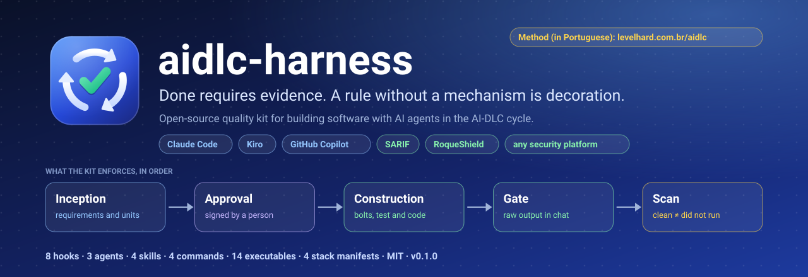
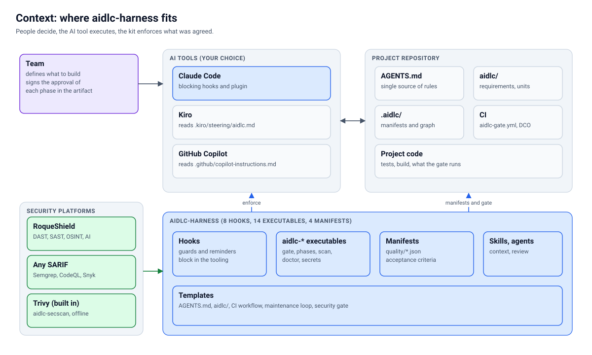
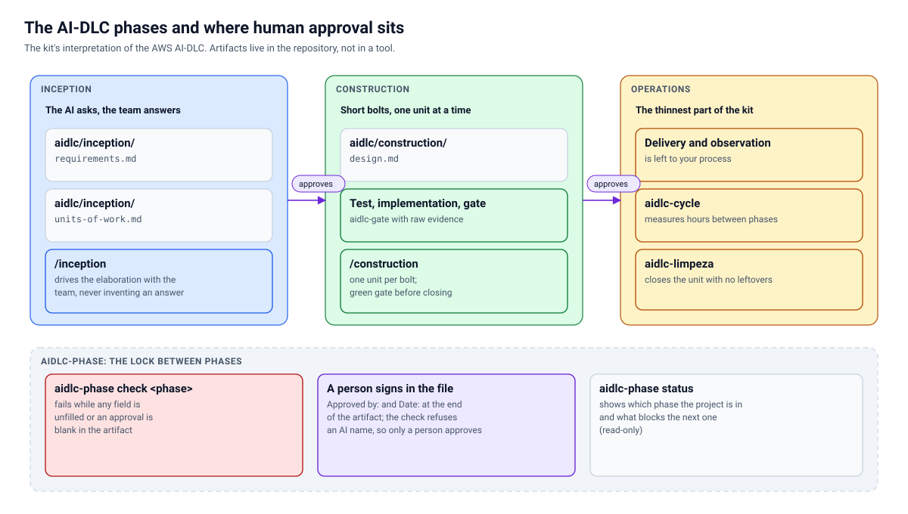
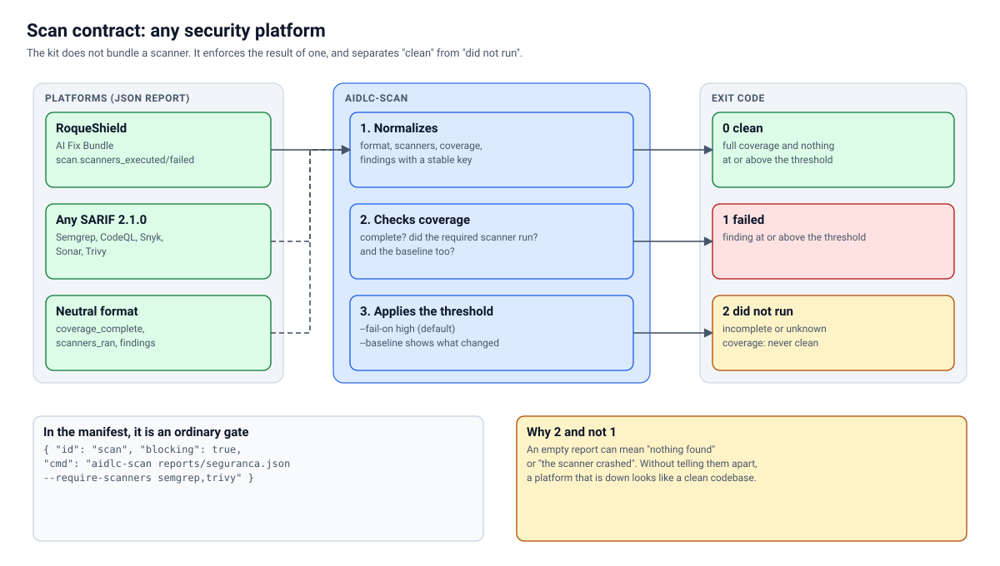
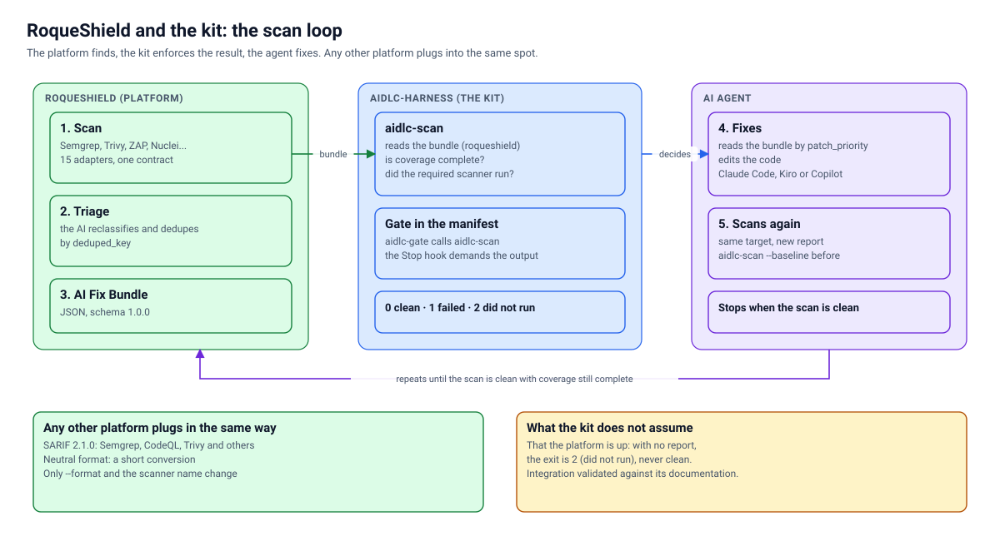

<p align="center">
  <a href="https://levelhard.com.br/aidlc">
    
  </a>
</p>

<p align="center">
  <a href="https://github.com/roqueribeiro/aidlc-harness/actions/workflows/ci.yml"></a>
  <a href="https://github.com/roqueribeiro/aidlc-harness/tags"></a>
  <a href="LICENSE"></a>
  <a href="docs/en/CONTRIBUTING.md#dco"></a>
  
  
  
</p>

<p align="center">
  <a href="docs/en/GETTING-STARTED.md"><b>Get started</b></a> ·
  <a href="docs/en/INDEX.md">Documentation</a> ·
  <a href="docs/en/ARCHITECTURE.md">Architecture</a> ·
  <a href="docs/en/REFERENCE.md">Reference</a> ·
  <a href="docs/en/INTEGRATIONS.md">Integrations</a> ·
  <a href="https://levelhard.com.br/aidlc">The method in practice (in Portuguese)</a> ·
  <a href="docs/en/CONTRIBUTING.md">Contributing</a> ·
  <a href="README.md">Português (Brasil)</a>
</p>

---

**A quality harness for building software with AI agents following the AI-DLC cycle**: the AI proposes, the team validates, and nothing is "done" without evidence. It works with **Claude Code**, **Kiro** and **GitHub Copilot**, and reads the report of **any security platform** (SARIF, the kit's neutral format, or the AI Fix Bundle of [RoqueShield](docs/en/ROQUESHIELD.md)). It does not depend on any specific product, company or stack.

> [!NOTE]
> **Pre-release (0.1.0).** What is described here exists and has tests. What has not yet been verified on a real machine is stated plainly in [Project status](#project-status) and in [Known limits](#known-limits). This project is a practical interpretation of AI-DLC; it is not AWS documentation or an AWS product ([docs/en/AIDLC.md](docs/en/AIDLC.md)).

## Contents

- [Why it exists](#why-it-exists)
- [Highlights](#highlights)
- [Project status](#project-status)
- [Get started in five minutes](#get-started-in-five-minutes)
- [How it works](#how-it-works)
- [The cycle](#the-cycle)
- [Security: any platform, including RoqueShield](#security-any-platform-including-roqueshield)
- [What ships in the kit](#what-ships-in-the-kit)
- [Compatibility: what each tool gets](#compatibility-what-each-tool-gets)
- [The method in practice](#the-method-in-practice)
- [Documentation](#documentation)
- [Known limits](#known-limits)
- [Gaps and next steps](#gaps-and-next-steps)
- [Contributing, security and license](#contributing-security-and-license)
- [About this translation](#about-this-translation)

## Why it exists

The symptom that motivated the kit: an agent delivers, a person reviews, and finds the same kind of problem for the fifth time. Not because the model is bad, but because every session starts over without knowing what the team has already decided and without anything that enforces "done". The bottleneck becomes review.

The kit addresses this with four decisions that are not about prompts:

1. **Acceptance criteria are data, not prose.** A JSON file says which command runs, which output fails and whether it blocks.
2. **Determinism beats the model when the task is mechanical.** If a check can be a script, it is a script.
3. **Evidence before "done".** The agent pastes the raw gate output into the chat, and a hook refuses to end the session without it.
4. **A person approves the phase.** The kit checks that the approval exists and was not filled in by an AI.

One rule runs through everything: **a rule without a mechanism is decoration.** Every norm in this repository points to the hook, gate or manifest that enforces it ([OPERATING-MODEL.md](docs/en/OPERATING-MODEL.md)).

## Highlights

| | |
| --- | --- |
| **Evidence gate** | `aidlc-gate` runs the acceptance criteria of the detected stack. The `Stop` hook refuses "done" without the raw output pasted into the chat. |
| **Phases with human approval** | `aidlc-phase check` fails on an unfilled field, a blank approval and an approval signed by an AI. |
| **A scan that did not run is not clean** | `aidlc-scan` separates three outcomes, not two: **0 clean**, **1 failed**, **2 did not run**. |
| **Any security platform** | SARIF 2.1.0, the neutral format and the RoqueShield AI Fix Bundle all enter through the same contract. |
| **Three tools, one source** | One `AGENTS.md` generates the instructions for Claude Code, Kiro and GitHub Copilot, and `aidlc-init --check` flags drift. |
| **Nothing that identifies a person or company** | `aidlc-identity` scans for IPs, emails, home paths, internal hostnames, secrets and your own denylist terms. |
| **Strategy at the moment the code is written** | Hooks deliver the right rule for the file that just changed, and the `strategy-map` survives `/compact`. |
| **Documentation that does not lie** | Diagrams are generated by code, the reference is checked against the disk, and every relative link is verified in CI. |

## Project status

| Item | Status | How it was measured |
| --- | --- | --- |
| Test suite (`node --test`) | **380 pass, 0 fail** on Linux | Linux (Node 22). On macOS arm64 (Node 22.23.2), the 365 tests of the previous revision passed on a clean clone; the 15 new ones have not run there yet |
| The repository's own gate (`aidlc-gate`) | **12 of 12 pass** on Linux | On a clean clone; on macOS, 11 of 11 passed in the previous revision (not re-run yet). The same checks run in CI on every push |
| `claude plugin validate --strict` | passes (plugin and marketplace) | Linux |
| New mechanisms | each with a **mutant** that fails | The mutation tests sit next to the code |
| Hooks inside Claude Code on macOS | **not exercised** | Only the suite and the gate ran there |
| Windows, Kiro, Copilot, Node 20.19 | **not tested** | Nobody ran them; see [Known limits](#known-limits) |
| RoqueShield link | validated against its documentation | Synthetic reports, not a running instance |

Current version: `0.1.0`. There is no compatibility promise between minor versions yet.

## Get started in five minutes

Prerequisites: **Node 20.19 or newer** and **git**. The step-by-step guide, with what to expect at each step, is in **[docs/en/GETTING-STARTED.md](docs/en/GETTING-STARTED.md)**. The short version:

```bash
# 1. Get the kit and put the executables on the PATH
git clone https://github.com/roqueribeiro/aidlc-harness.git
node aidlc-harness/scripts/setup.mjs

# 2. In Claude Code: register the marketplace and install the plugin
#    claude plugin marketplace add roqueribeiro/aidlc-harness
#    claude plugin install aidlc-harness@aidlc

# 3. In your project
cd meu-projeto
aidlc-init --name "Meu Projeto" --desc "uma frase"
aidlc-phase status
aidlc-gate
```

After `aidlc-init`, the team fills in `aidlc/inception/` with the AI asking the questions, and a person signs the approval in the file itself. Construction only starts after that.

### See the contract in action

The example reports in [`docs/exemplos/scan/`](docs/exemplos/scan/) are executed by the repository's tests. The output below is real. The executables print their messages in Portuguese, so the output is shown verbatim (`REPROVADO` means failed, `NAO RODOU` means did not run, `saída` means exit code):

```console
$ aidlc-scan docs/exemplos/scan/neutro-reprovado.json; echo "saída $?"
aidlc-scan  docs/exemplos/scan/neutro-reprovado.json  (neutro; scanners: semgrep, trivy)
REPROVADO: 1 achado(s) em high ou acima
  [high] Consulta SQL montada por concatenacao  src/db/usuarios.js:41
saída 1

$ aidlc-scan docs/exemplos/scan/neutro-nao-rodou.json; echo "saída $?"
aidlc-scan  docs/exemplos/scan/neutro-nao-rodou.json  (neutro; scanners: semgrep)
NAO RODOU: cobertura incompleta: algum scanner nao rodou ou falhou
saída 2
```

The second run is the point of the contract: the list of findings is empty, and it is still **not** a clean result.

## How it works

<picture>
  <source media="(prefers-color-scheme: dark)" srcset="docs/assets/diagramas/contexto.en.escuro.svg">
  
</picture>

The team decides, the AI tool executes and the kit enforces what was agreed. Inside, there are hooks that Claude Code fires, `aidlc-*` executables that cost no tokens, per-stack quality manifests and three support agents. The full design, with the diagrams of hooks, manifest layers and the `Stop` decision, is in **[docs/en/ARCHITECTURE.md](docs/en/ARCHITECTURE.md)**.

## The cycle

<picture>
  <source media="(prefers-color-scheme: dark)" srcset="docs/assets/diagramas/fases.en.escuro.svg">
  
</picture>

`aidlc/decisions.md` keeps what was decided and is not reopened. [docs/en/AIDLC.md](docs/en/AIDLC.md) maps each phase to what the kit does and says where it departs from the original method.

## Security: any platform, including RoqueShield

The kit does not embed a scanner: it **enforces the result of one**, with a rule that does not change: *a scan that did not run is not a clean scan.* In the manifest, `aidlc-scan` is an ordinary gate.

<picture>
  <source media="(prefers-color-scheme: dark)" srcset="docs/assets/diagramas/varredura.en.escuro.svg">
  
</picture>

| The platform exports | How it enters |
| --- | --- |
| AI Fix Bundle from [RoqueShield](docs/en/ROQUESHIELD.md) (open source, Apache-2.0, alpha) | `aidlc-scan relatorio.json --format roqueshield` |
| SARIF 2.1.0 (Semgrep, CodeQL, Trivy and others) | `aidlc-scan relatorio.sarif --format sarif` |
| Any other JSON | convert it to the neutral format ([recipe](docs/en/INTEGRATIONS.md#5-recipes-by-platform)) |

| Exit | Meaning | When |
| --- | --- | --- |
| `0` | clean | full coverage and no finding at the threshold (`--fail-on`, default `high`) |
| `1` | failed | there is a finding at `high` or above |
| `2` | did not run | report missing, unreadable, of unknown format, or coverage incomplete |

The kit **does not depend** on RoqueShield, and RoqueShield does not depend on the kit: it is one of the platforms that enter through the same contract. What is and is not verified in that link is in [docs/en/ROQUESHIELD.md](docs/en/ROQUESHIELD.md).

<picture>
  <source media="(prefers-color-scheme: dark)" srcset="docs/assets/diagramas/roqueshield.en.escuro.svg">
  
</picture>

## What ships in the kit

| Piece | What it does |
| --- | --- |
| `aidlc-init` | Prepares a project: instructions for the three tools from one `AGENTS.md`, cycle folders, CI workflow |
| `aidlc-phase` | Phase state. `check inception` fails on an unfilled field and a blank approval |
| `aidlc-gate` | Runs the acceptance criteria of the detected stack and exits with 1 if a blocking gate fails |
| `aidlc-identity` | Scans the repository for IPs, emails, home paths, internal hostnames, secrets and terms you forbid |
| `aidlc-doctor` | Grades the repository against the standard and says what is missing, with weights |
| `aidlc-scan` | Reads the report of any security platform and separates **clean** from **did not run** ([INTEGRATIONS.md](docs/en/INTEGRATIONS.md)) |
| `aidlc-secrets`, `aidlc-secscan`, `aidlc-lockcheck` | A vault the agent uses without seeing, CVEs with a published fix, dependencies outside the lockfile |
| `aidlc-mutation`, `aidlc-limpeza`, `aidlc-cycle`, `aidlc-graph`, `aidlc-harness` | Mutation test, clean bench, cycle dashboard, blast radius across repositories, context cost |
| Hooks (Claude Code) | `dod-check` (Stop), `promise-check`, `secret-guard`, `pkg-manager`, `strategy-map`, `path-strategy`, `session-brief`, `scratch-guard` |
| Agents | `advisor`, `scanner`, `supply-chain-reviewer` |
| Skills and commands | `aidlc-context`, `bolts`, `blast`, `repo-standard`, `/inception`, `/construction`, `/gate`, `/status` |

The full list, with options, fields and variables, is in [docs/en/REFERENCE.md](docs/en/REFERENCE.md). A repository check fails if something exists on disk and is not listed there.

## Compatibility: what each tool gets

The kit applies rules in two ways: **instruction** (the agent reads it and should follow it) and **mechanism** (something actually blocks or fails). The difference matters.

| | Claude Code | Kiro | GitHub Copilot |
| --- | --- | --- | --- |
| Project instructions | `CLAUDE.md` imports `AGENTS.md` | `AGENTS.md` and `.kiro/steering/aidlc.md` | `.github/copilot-instructions.md` |
| Blocking hooks (evidence at Stop, secret, package manager) | yes, through the plugin | no | no |
| `aidlc-*` executables | yes | yes, via `setup` | yes, via `setup` |
| Gate in CI (`aidlc-gate.yml`) | yes | yes | yes |

In short: in Claude Code the kit blocks; in Kiro and Copilot it instructs and CI checks. Details, and what to verify in your version of each tool: [docs/en/ADAPTERS.md](docs/en/ADAPTERS.md). For regulated companies, see the profile in [docs/en/REGULATED.md](docs/en/REGULATED.md).

## The method in practice

The kit is the executable part of a method. The explanation of the method, in plain language, with the six-station cycle (sense, decide, build, publish, operate and measure, evolve), the agents' autonomy levels, the "done only with proof" rule and the results, is in the companion material (in Portuguese):

**[levelhard.com.br/aidlc: AI-DLC in practice, from the user signal to the store](https://levelhard.com.br/aidlc)** (the material is in Portuguese)

The material and this repository complement each other: the why and the end-to-end view are there, the mechanisms that enforce each rule are here.

## Documentation

The full map is in **[docs/en/INDEX.md](docs/en/INDEX.md)**. The main ones:

| Document | What for |
| --- | --- |
| [GETTING-STARTED](docs/en/GETTING-STARTED.md) | The seven-step path, from clone to the first gate |
| [ARCHITECTURE](docs/en/ARCHITECTURE.md) | How it is built inside, with diagrams |
| [REFERENCE](docs/en/REFERENCE.md) | Every executable, hook, command, field and variable |
| [INTEGRATIONS](docs/en/INTEGRATIONS.md) | Security platforms, CI and AI tools |
| [ROQUESHIELD](docs/en/ROQUESHIELD.md) | The link with RoqueShield, with its state stated plainly |
| [AIDLC](docs/en/AIDLC.md) | The method and how the kit interprets it |
| [ADAPTERS](docs/en/ADAPTERS.md) | Claude Code, Kiro and Copilot |
| [REGULATED](docs/en/REGULATED.md) | Profile for regulated companies |
| [EXTENDING](docs/en/EXTENDING.md) | How to add a technology, a reviewer, a rule |
| [WHEN-IT-BREAKS](docs/en/WHEN-IT-BREAKS.md) | What each gate result means |
| [STRATEGY](docs/en/STRATEGY.md) | The reasoning behind the decisions |
| [GLOSSARY](docs/en/GLOSSARY.md) | Terms and frequently asked questions |
| [OPERATING-MODEL](docs/en/OPERATING-MODEL.md) | The operating model, with the mechanism of each rule |

## Known limits

Stated plainly, so you do not find out at the wrong moment:

- **Tested:** Linux and macOS (arm64), with Node 22. The repository suites (`node --test`) cover hooks, phases, the identity scanner, `aidlc-init`, installation and manifests, and each new mechanism was tested with mutants. On macOS the suite and the gate of the previous revision ran, on one machine.
- **Not tested on a real machine:** Windows (`setup` generates `.cmd` shortcuts, but nobody ran them), Kiro and Copilot. The file conventions of those two tools were checked against public documentation, and documentation changes. The declared Node floor is 20.19, but only 22 was exercised; CI runs a matrix.
- **The RoqueShield link was validated against its documentation**, with synthetic reports, not against a running instance. SARIF and the neutral format are tested with the examples in `docs/exemplos/scan/`; the invocation of each external scanner is not.
- **Hooks exist only in Claude Code.** In Kiro and Copilot, what prevents a "done" without evidence is CI and human review.
- **The identity scanner finds formats, not names.** It catches IPs, emails, home paths, hostnames and secrets. The name of a person, customer or internal system is only caught if it is in your denylist, which lives outside the repository.
- **`aidlc-phase` checks form, not truth.** It guarantees that the approval exists and is not from an AI. Whether the written name belongs to whoever really approved is human review.
- **A SARIF from a tool that crashed without recording the invocation reads as full coverage.** Compensate with `--require-scanners` ([INTEGRATIONS.md](docs/en/INTEGRATIONS.md#sarif-210)).

## Gaps and next steps

No promised dates. This is what does not exist yet:

- [ ] Platform API client: today the kit reads a file, and downloading the report is a step in your pipeline.
- [ ] MCP server and GitHub Action for the kit: the executables are the contract for now.
- [ ] "Accepted finding with a deadline" in `aidlc-scan` (it exists in `aidlc-secscan`, through an allowlist with `# expira:`).
- [ ] A test of the full loop against a RoqueShield instance, and of the recipes for each external scanner.
- [ ] Verification on Windows, Kiro and Copilot, with reports from whoever uses them.
- [x] Documentation in English: this README and [docs/en/](docs/en/INDEX.md) (Portuguese is the primary version, and `check-i18n` enforces the pair).
- [ ] Adapter for Codex (scope decision: out of 0.1).

## Contributing, security and license

- **Contributing:** read [CONTRIBUTING.md](docs/en/CONTRIBUTING.md). The flow requires tests, a **mutant for every new check** and commits signed off with `git commit -s` ([DCO](docs/en/CONTRIBUTING.md#dco)). Test reports from Windows, Kiro and Copilot are especially useful.
- **Security:** vulnerabilities are reported privately, as [SECURITY.md](SECURITY.md) says. Do not open a public issue.
- **Conduct:** [CODE_OF_CONDUCT.md](CODE_OF_CONDUCT.md).
- **License:** [MIT](LICENSE).

## About this translation

This is the English translation of the [README in Brazilian Portuguese](README.md), which is the primary version. If they differ, the Portuguese one wins. The documentation under `docs/en/` follows the same rule. The plugin's executables, hooks, agents and commands speak Portuguese, and the method material at [levelhard.com.br/aidlc](https://levelhard.com.br/aidlc) is in Portuguese.
