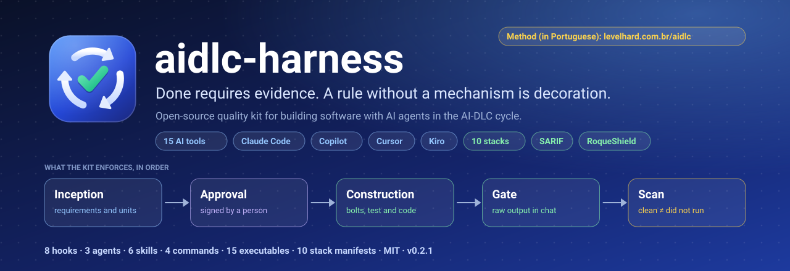
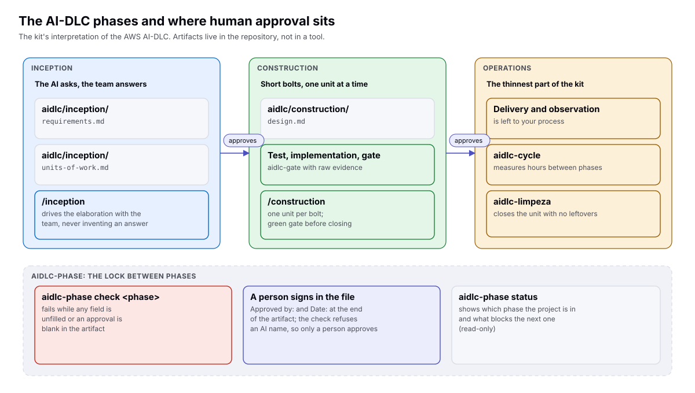

<p align="center">
  <a href="https://levelhard.com.br/aidlc">
    
  </a>
</p>

<p align="center">
  <a href="https://github.com/roqueribeiro/aidlc-harness/actions/workflows/ci.yml"></a>
  <a href="https://github.com/roqueribeiro/aidlc-harness/tags"></a>
  <a href="LICENSE"></a>
  <a href="CONTRIBUTING.md#dco"></a>
  
  
  <a href="docs/TOOLS.md"></a>
</p>

<p align="center">
  <a href="docs/GETTING-STARTED.md"><b>Get started</b></a> ·
  <a href="docs/TOOLS.md"><b>Your AI tool, step by step</b></a> ·
  <a href="docs/INDEX.md">Documentation</a> ·
  <a href="docs/REFERENCE.md">Reference</a> ·
  <a href="https://levelhard.com.br/aidlc">The method in practice (in Portuguese)</a> ·
  <a href="README.pt-BR.md">Português (Brasil)</a>
</p>

---

**aidlc-harness takes a one-sentence request to approved requirements and then to code that only counts as done with evidence, inside the AI tool your team already uses.** The AI drafts everything with its own recommendations and asks only what it cannot decide, in the tool's own question window; a person approves each phase; and a gate refuses "done" without the raw test output. It works in **15 AI tools** (Claude Code, GitHub Copilot, Cursor, Kiro, OpenCode, Codex, Gemini CLI, Antigravity and more) and in **10 technology stacks**, from Node to Java, .NET and Go.

> [!NOTE]
> **Version 0.2, pre-release.** Everything described here exists and has tests, and CI runs on Linux, macOS and Windows. Which AI tools were exercised on a real machine is stated tool by tool in [Project status](#project-status). This project is a practical interpretation of AI-DLC; it is not AWS documentation or an AWS product ([docs/AIDLC.md](docs/AIDLC.md)).

## Contents

- [Get started in one minute](#get-started-in-one-minute)
- [Your AI tool](#your-ai-tool)
- [An Inception that does not feel like a phone menu](#an-inception-that-does-not-feel-like-a-phone-menu)
- [Why it exists](#why-it-exists)
- [How it works](#how-it-works)
- [What ships in the kit](#what-ships-in-the-kit)
- [Security: any platform, including RoqueShield](#security-any-platform-including-roqueshield)
- [Project status](#project-status)
- [Known limits](#known-limits)
- [Documentation](#documentation)
- [Contributing, security and license](#contributing-security-and-license)
- [Languages](#languages)

## Get started in one minute

Prerequisites: **Node 20.19 or newer** and **git**. In your project's folder:

```bash
npx github:roqueribeiro/aidlc-harness init
```

In a terminal it asks which AI tools the team uses (the ones it finds in the folder come already checked) and creates, for each one, the commands in that tool's own format. Then open your tool and run the Inception with one sentence about what you want, for example `/aidlc-inception I want a customer registry with search and change history`. The exact command for each tool is in the table below and in `.aidlc/COMANDOS.md` in your project.

That is the only command. Nothing else to install:

- **The kit copies itself into the project** (`.aidlc/kit/`, committed with the rest), and hooks, gate and phases run from that copy: `node .aidlc/kit/tools/aidlc-gate`. A teammate who clones the repository has everything working.
- **Claude Code loads the plugin from the project**: `.claude/settings.json` registers the kit marketplace, pinned to this version, and the plugin loads when you accept the workspace trust dialog.
- **Trivy comes by itself**: the first gate downloads the version pinned in the kit, checked by sha256, into a cache.

CI tests exactly this on Linux, macOS and Windows: a machine with no `aidlc` on the `PATH` and an empty home, from `init` to a green gate, and a fresh clone. The full path, with what to expect at each step, is in **[docs/GETTING-STARTED.md](docs/GETTING-STARTED.md)**. To also have the `aidlc-*` commands on your `PATH` for other projects, `npm install -g github:roqueribeiro/aidlc-harness` is optional.

## Your AI tool

Each tool receives the Inception and Construction commands in its own folder and format, and each command names that tool's question window. Where the tool allows hooks, the kit also holds a "done" that has no green gate behind it.

<!-- ferramentas:inicio -->
| Tool | Command | Question window | Kit hooks | Page |
| --- | --- | --- | --- | --- |
| Claude Code | `/inception` | `AskUserQuestion` | yes | [step by step](docs/tools/claude.md) |
| OpenCode | `/aidlc-inception` | `question` | no | [step by step](docs/tools/opencode.md) |
| Kilo Code | `/aidlc-inception` | `question` | no | [step by step](docs/tools/kilo.md) |
| GitHub Copilot | `/aidlc-inception` (in VS Code; in the Copilot CLI, ask for the aidlc-inception skill) | `askQuestions` | yes | [step by step](docs/tools/copilot.md) |
| Cursor | `/aidlc-inception` | `Ask questions` | yes | [step by step](docs/tools/cursor.md) |
| Gemini CLI | `/aidlc:inception` | `ask_user` | no | [step by step](docs/tools/gemini.md) |
| Google Antigravity | `/aidlc-inception` (the skill becomes a command) | answer picker | no | [step by step](docs/tools/antigravity.md) |
| Kiro | `/aidlc-inception` (or #aidlc-inception in the chat) | none: text with lettered options | no | [step by step](docs/tools/kiro.md) |
| OpenAI Codex | `$aidlc-inception` (after entering Plan mode with /plan) | `request_user_input` | yes | [step by step](docs/tools/codex.md) |
| Devin Desktop (ex-Windsurf) | `/aidlc-inception` (the skill becomes a command) | `ask_user_question` | no | [step by step](docs/tools/devin.md) |
| Cline | `/aidlc-inception.md` | `ask_question` | no | [step by step](docs/tools/cline.md) |
| JetBrains Junie | `/aidlc-inception` | `AskUserQuestion` | no | [step by step](docs/tools/junie.md) |
| Continue | `/aidlc-inception` | `AskQuestion` | no | [step by step](docs/tools/continue.md) |
| Augment (Auggie) | `/aidlc-inception` | none: text with lettered options | no | [step by step](docs/tools/augment.md) |
| Zed | `/aidlc-inception` (the skill becomes a command) | none: text with lettered options | no | [step by step](docs/tools/zed.md) |
<!-- ferramentas:fim -->

This table is generated from the same adapters that `aidlc-init` applies, and CI fails if it drifts. Where the kit has no hook, CI enforces the evidence: the `aidlc-gate.yml` workflow that `aidlc-init` creates runs on every push in every tool.

## An Inception that does not feel like a phone menu

The slow way to gather requirements is twenty questions before anything is written. The kit does the opposite:

1. **Reads first.** `AGENTS.md`, the product context, the decisions already made, the code, and whatever you put in `aidlc/inception/insumos/` (a meeting transcript, a brief, a screenshot). What is already answered there does not become a question.
2. **Drafts everything.** Requirements, stories with verifiable acceptance criteria and units of work, filled in with the AI's recommendations. Every choice it made alone is listed under **Premissas** (assumptions), with the reason.
3. **Asks only what it cannot decide.** At most five questions, only on what is irreversible, business, scope, compliance, cost or naming, in the tool's own question window, with the recommended option first. "Accept all recommendations" is always one click (or one "ok" where there is no window).
4. **A person approves.** `aidlc-phase check inception` fails with more than five open questions, with assumptions nobody reviewed, or with an approval signed by an AI.

The method lives in one place, the `aidlc-inception` skill, which every tool reads. The full text is in [plugins/aidlc-harness/skills/aidlc-inception/SKILL.md](plugins/aidlc-harness/skills/aidlc-inception/SKILL.md).

## Why it exists

An agent delivers, a person reviews, and finds the same kind of problem for the fifth time. Not because the model is bad, but because every session starts over without knowing what the team has already decided and without anything that enforces "done". The bottleneck becomes review.

The kit answers with four decisions that are not about prompts:

1. **Acceptance criteria are data, not prose.** A JSON file per technology says which command runs, which output fails and whether it blocks.
2. **Determinism beats the model when the task is mechanical.** If a check can be a script, it is a script.
3. **Evidence before "done".** The gate's raw output, not a summary.
4. **A person approves the phase.** The kit checks that the approval exists and was not filled in by an AI.

One rule runs through everything: **a rule without a mechanism is decoration.** Every norm in this repository points to the hook, gate or manifest that enforces it ([OPERATING-MODEL.md](OPERATING-MODEL.md)).

## How it works

<picture>
  <source media="(prefers-color-scheme: dark)" srcset="docs/assets/diagramas/fases.en.escuro.svg">
  
</picture>

The team decides, the AI tool executes and the kit enforces what was agreed: instructions every tool reads (`AGENTS.md`), one command per phase in each tool, `aidlc-*` executables that cost no tokens, per-stack quality manifests and, where the tool allows, hooks. `aidlc/decisions.md` keeps what was decided and is not reopened. The design, with diagrams, is in **[docs/ARCHITECTURE.md](docs/ARCHITECTURE.md)**.

## What ships in the kit

| Piece | What it does |
| --- | --- |
| `aidlc-init` | Prepares a project for the chosen tools: `AGENTS.md` (a managed block if the team already has one), commands, skills, hooks, cycle folders and a CI workflow for the detected stack |
| `aidlc-phase` | Phase state; `check inception` fails on an unfilled field, more than five open questions, unreviewed assumptions or an AI's approval |
| `aidlc-gate` | Runs the acceptance criteria of the detected stack (Node with npm, yarn, pnpm or bun, Python with uv, Java with Maven or Gradle, .NET, Go) |
| `aidlc-hook` | The kit hooks for GitHub Copilot, Cursor and Codex: secret and package-manager guards, and an end-of-turn check that the gate is green on the current tree |
| `aidlc-doctor` | Grades the repository against the standard and says what is missing, only for the tools the project uses |
| `aidlc-scan` | Reads the report of any security platform and separates **clean** from **did not run** |
| `aidlc-identity` | Scans for IPs, emails, home paths, internal hostnames, secrets and your own denylist terms |
| `aidlc-secrets`, `aidlc-secscan`, `aidlc-lockcheck` | A vault the agent uses without seeing, CVEs with a published fix, dependencies outside the lockfile |
| `aidlc-mutation`, `aidlc-limpeza`, `aidlc-cycle`, `aidlc-graph`, `aidlc-harness` | Mutation test, clean bench, cycle dashboard, blast radius across repositories, context cost |
| Claude Code plugin | Blocking hooks, agents (`advisor`, `scanner`, `supply-chain-reviewer`), skills and the `/inception`, `/construction`, `/gate`, `/status` commands |

The full list, with options, fields and variables, is in [docs/REFERENCE.md](docs/REFERENCE.md). A repository check fails if something exists on disk and is not listed there.

## Security: any platform, including RoqueShield

The kit does not embed a scanner: it **enforces the result of one**, with a rule that does not change: *a scan that did not run is not a clean scan.* SARIF 2.1.0 (Semgrep, CodeQL, Trivy and others), the kit's neutral format and the AI Fix Bundle of [RoqueShield](docs/ROQUESHIELD.md) enter through the same contract.

```console
$ aidlc-scan docs/exemplos/scan/neutro-nao-rodou.json; echo "exit $?"
aidlc-scan  docs/exemplos/scan/neutro-nao-rodou.json  (neutro; scanners: semgrep)
NAO RODOU: cobertura incompleta: algum scanner nao rodou ou falhou
exit 2
```

The list of findings in that report is empty, and the result is still **not** clean (`NAO RODOU` means "did not run"). Exit `0` is clean, `1` failed, `2` did not run. Details in [docs/INTEGRATIONS.md](docs/INTEGRATIONS.md).

## Project status

| Item | Status | How it was measured |
| --- | --- | --- |
| Test suite (`node --test`) | **504 pass, 0 fail** (1 skipped: runs only on Windows, in CI) | Linux, Node 22, 2026-11-06 |
| Continuous integration | green on **Linux, macOS and Windows**, Node 20, 22 and 24 | GitHub Actions on every push, including the clean-machine test and the installed package |
| Install with `npx github:…` and `npm install -g github:…` | works | run from GitHub on 2026-11-06, and in CI from a packed tarball on the three systems |
| First run with nothing installed | `init`, hooks, phases and a green gate (Trivy downloaded and checked) from the project copy, and a fresh clone | `scripts/primeira-execucao.test.mjs`, in CI on Linux, macOS and Windows with no `aidlc` on the `PATH` and an empty home |
| Gates of the new stacks | Go, bun, Maven, pnpm and yarn run green and red on a real project | Linux, 2026-11-06; Gradle red only (the network blocked the green run); .NET not run |
| New mechanisms | each with a **mutant** that fails | the mutation tests sit next to the code |
| The 15 AI tools on a real machine | **not yet exercised** | each tool's files and question window were checked against its official documentation on 2026-11-06; prints from real sessions go to `docs/compatibilidade/` |

There is no compatibility promise between minor versions yet.

## Known limits

- **AI tools change every month.** What each page says was checked on 2026-11-06 against the tool's documentation. A tool is marked verified only with a print of a real session.
- **Hooks exist in Claude Code, GitHub Copilot, Cursor and Codex.** In the other tools, what holds an unproven "done" is CI and human review.
- **Kiro, Augment and Zed have no question window**: the Inception asks in short text with lettered options, the recommended one marked.
- **The identity scanner finds formats, not names.** The name of a person, customer or internal system is only caught if it is in your denylist, which lives outside the repository.
- **`aidlc-phase` checks form, not truth.** It guarantees that the approval exists and is not from an AI; whether the name belongs to whoever really approved is human review.
- **The kit's own messages are in Brazilian Portuguese** (executables, hooks, prompts). The documentation is in English and Brazilian Portuguese.

## Documentation

Start with **[docs/GETTING-STARTED.md](docs/GETTING-STARTED.md)** and **[docs/TOOLS.md](docs/TOOLS.md)**. The full map is in [docs/INDEX.md](docs/INDEX.md):

| Document | What for |
| --- | --- |
| [TOOLS](docs/TOOLS.md) | Each AI tool, step by step |
| [ARCHITECTURE](docs/ARCHITECTURE.md) | How it is built inside, with diagrams |
| [REFERENCE](docs/REFERENCE.md) | Every executable, hook, command, field and variable |
| [AIDLC](docs/AIDLC.md) | The method and how the kit interprets it |
| [ADAPTERS](docs/ADAPTERS.md) | What each tool gets, instruction versus mechanism |
| [REGULATED](docs/REGULATED.md) | Profile for regulated companies |
| [INTEGRATIONS](docs/INTEGRATIONS.md) | Security platforms, CI and AI tools |
| [WHEN-IT-BREAKS](docs/WHEN-IT-BREAKS.md) | What each gate result means |

The method behind the kit, in plain language, is at **[levelhard.com.br/aidlc](https://levelhard.com.br/aidlc)** (in Portuguese).

## Contributing, security and license

- **Contributing:** [CONTRIBUTING.md](CONTRIBUTING.md). Every new check comes with a mutant, and commits are signed off with `git commit -s` ([DCO](CONTRIBUTING.md#dco)). Reports from real sessions in each AI tool are the most useful contribution right now.
- **Security:** report vulnerabilities privately, as [SECURITY.md](SECURITY.md) says.
- **Conduct:** [CODE_OF_CONDUCT.md](CODE_OF_CONDUCT.md).
- **License:** [MIT](LICENSE).

## Languages

English is the primary language of this repository, and every document has a Brazilian Portuguese pair: [README.pt-BR.md](README.pt-BR.md) and [docs/pt-BR/](docs/pt-BR/INDEX.md). If the two differ, the English one wins, and `check-i18n` fails CI when a pair falls behind. The kit itself speaks Brazilian Portuguese (executable messages, hooks, prompts and commands).
