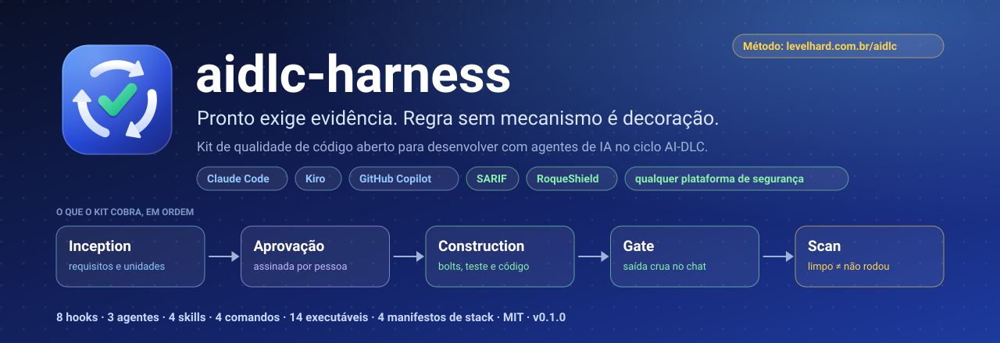
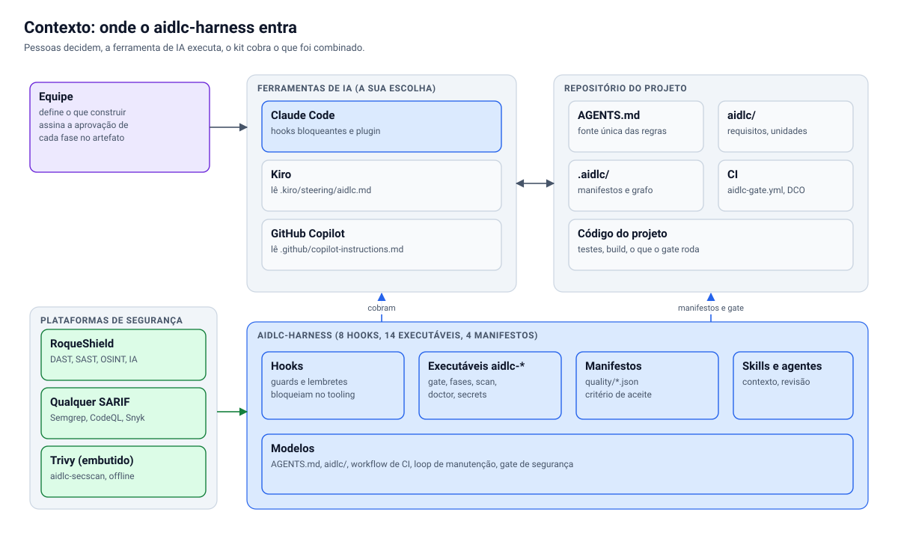
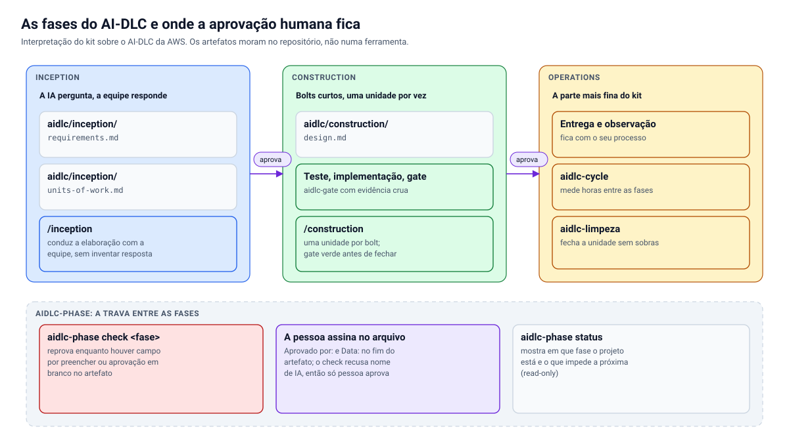
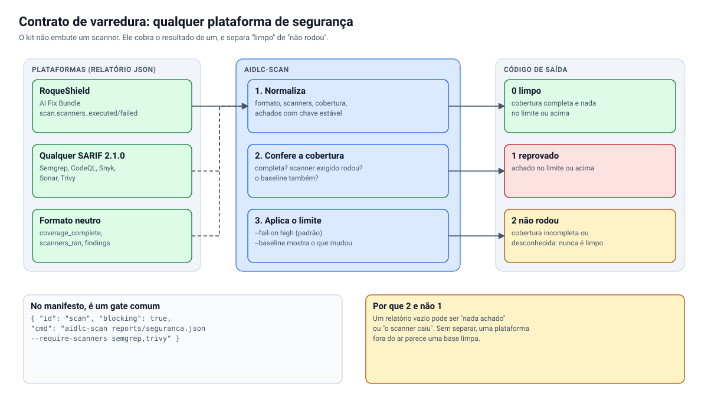
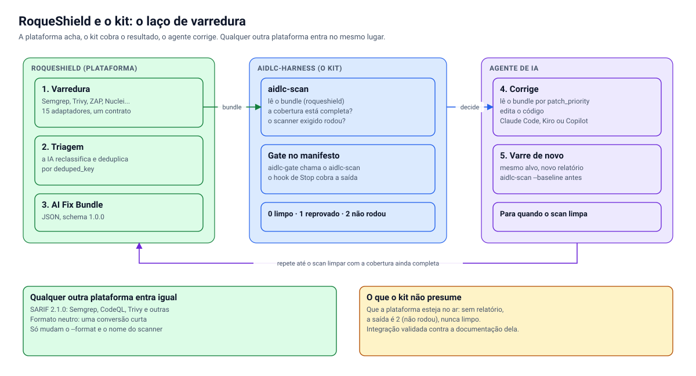

<p align="center">
  <a href="https://levelhard.com.br/aidlc">
    
  </a>
</p>

<p align="center">
  <a href="https://github.com/roqueribeiro/aidlc-harness/actions/workflows/ci.yml"></a>
  <a href="https://github.com/roqueribeiro/aidlc-harness/tags"></a>
  <a href="LICENSE"></a>
  <a href="docs/pt-BR/CONTRIBUTING.md#dco"></a>
  
  
  
</p>

<p align="center">
  <a href="docs/pt-BR/COMECAR.md"><b>Começar</b></a> ·
  <a href="docs/pt-BR/INDEX.md">Documentação</a> ·
  <a href="docs/pt-BR/ARQUITETURA.md">Arquitetura</a> ·
  <a href="docs/pt-BR/REFERENCIA.md">Referência</a> ·
  <a href="docs/pt-BR/INTEGRACOES.md">Integrações</a> ·
  <a href="https://levelhard.com.br/aidlc">O método na prática</a> ·
  <a href="docs/pt-BR/CONTRIBUTING.md">Contribuir</a> ·
  <a href="README.md">English</a>
</p>

---

**Um harness de qualidade para desenvolver software com agentes de IA seguindo o ciclo AI-DLC**: a IA propõe, a equipe valida, e nada é "pronto" sem evidência. Funciona com **Claude Code**, **Kiro** e **GitHub Copilot**, e lê o relatório de **qualquer plataforma de segurança** (SARIF, o formato neutro do kit, ou o AI Fix Bundle do [RoqueShield](docs/pt-BR/ROQUESHIELD.md)). Não depende de nenhum produto, empresa ou stack específica.

> [!NOTE]
> **Pré-lançamento (0.1.0).** O que está descrito aqui existe e tem teste. O que ainda não foi verificado em máquina real está dito, sem enfeite, em [Estado do projeto](#estado-do-projeto) e em [Limites conhecidos](#limites-conhecidos). Este projeto é uma interpretação prática do AI-DLC; não é documentação nem produto da AWS ([docs/pt-BR/AIDLC.md](docs/pt-BR/AIDLC.md)).

## Sumário

- [Por que existe](#por-que-existe)
- [Destaques](#destaques)
- [Estado do projeto](#estado-do-projeto)
- [Começar em cinco minutos](#começar-em-cinco-minutos)
- [Como funciona](#como-funciona)
- [O ciclo](#o-ciclo)
- [Segurança: qualquer plataforma, inclusive o RoqueShield](#segurança-qualquer-plataforma-inclusive-o-roqueshield)
- [O que vem no kit](#o-que-vem-no-kit)
- [Compatibilidade](#compatibilidade-o-que-cada-ferramenta-recebe)
- [O método na prática](#o-método-na-prática)
- [Documentação](#documentação)
- [Limites conhecidos](#limites-conhecidos)
- [Lacunas e próximos passos](#lacunas-e-próximos-passos)
- [Contribuir, segurança e licença](#contribuir-segurança-e-licença)
- [Idiomas](#idiomas)

## Por que existe

O sintoma que motivou o kit: um agente entrega, a pessoa revisa, e encontra o mesmo tipo de problema pela quinta vez. Não porque o modelo seja ruim, mas porque cada sessão recomeça sem saber o que a equipe já decidiu e sem nada que cobre o "pronto". O gargalo vira a revisão.

O kit trata isso com quatro decisões que não são sobre prompt:

1. **Critério de aceite é dado, não prosa.** Um arquivo JSON diz qual comando roda, que saída reprova e se bloqueia.
2. **Determinismo vence modelo quando a tarefa é mecânica.** Se uma checagem pode ser um script, é um script.
3. **Evidência antes de "pronto".** O agente cola a saída crua do gate no chat, e um hook recusa encerrar a sessão sem ela.
4. **Quem aprova a fase é uma pessoa.** O kit confere que a aprovação existe e que não foi preenchida por uma IA.

Uma regra atravessa tudo: **regra sem mecanismo é decoração.** Cada norma deste repositório aponta para o hook, o gate ou o manifesto que a executa ([docs/pt-BR/OPERATING-MODEL.md](docs/pt-BR/OPERATING-MODEL.md)).

## Destaques

| | |
| --- | --- |
| **Gate de evidência** | `aidlc-gate` roda o critério de aceite da stack detectada. O hook de `Stop` recusa o "pronto" sem a saída crua colada no chat. |
| **Fases com aprovação humana** | `aidlc-phase check` reprova campo por preencher, aprovação em branco e aprovação assinada por IA. |
| **Um scan que não rodou não é limpo** | `aidlc-scan` separa três saídas, não duas: **0 limpo**, **1 reprovado**, **2 não rodou**. |
| **Qualquer plataforma de segurança** | SARIF 2.1.0, formato neutro e AI Fix Bundle do RoqueShield entram pelo mesmo contrato. |
| **Três ferramentas, uma fonte** | Um `AGENTS.md` gera as instruções para Claude Code, Kiro e GitHub Copilot, e o `aidlc-init --check` acusa a deriva. |
| **Nada que identifique pessoa ou empresa** | `aidlc-identity` varre IP, e-mail, caminho de home, hostname interno, segredo e a sua lista de termos proibidos. |
| **Estratégia na hora em que o código é escrito** | Hooks entregam a regra certa para o arquivo que acabou de mudar, e o `strategy-map` sobrevive ao `/compact`. |
| **Documentação que não mente** | Os diagramas são gerados por código, a referência é conferida contra o disco, e todo link relativo é verificado no CI. |

## Estado do projeto

| Item | Estado | Como foi medido |
| --- | --- | --- |
| Suíte de testes (`node --test`) | **381 passam, 0 falham** no Linux | Linux (Node 22). No macOS arm64 (Node 22.23.2), os 365 testes de uma versão anterior passaram em clone limpo; os mais novos ainda não rodaram lá |
| Gate do próprio repositório (`aidlc-gate`) | **12 de 12 passam** no Linux | Em clone limpo; no macOS, 11 de 11 passaram na versão anterior (ainda não reexecutado). Os mesmos checks rodam no CI a cada push |
| `claude plugin validate --strict` | passa (plugin e marketplace) | Linux |
| Mecanismos novos | cada um com **mutante** que reprova | Os testes de mutação estão ao lado do código |
| Hooks dentro do Claude Code no macOS | **não exercitados** | Só a suíte e o gate rodaram lá |
| Windows, Kiro, Copilot, Node 20.19 | **não testados** | Ninguém executou; veja [Limites conhecidos](#limites-conhecidos) |
| Ligação com o RoqueShield | validada contra a documentação dele | Relatórios sintéticos, não uma instância em execução |

Versão atual: `0.1.0`. Ainda não há promessa de compatibilidade entre versões menores.

## Começar em cinco minutos

Pré-requisitos: **Node 20.19 ou mais novo** e **git**. O guia passo a passo, com o que esperar em cada passo, está em **[docs/pt-BR/COMECAR.md](docs/pt-BR/COMECAR.md)**. O resumo:

```bash
# 1. Pegue o kit e ponha os executáveis no PATH
git clone https://github.com/roqueribeiro/aidlc-harness.git
node aidlc-harness/scripts/setup.mjs

# 2. No Claude Code: registre o marketplace e instale o plugin
#    claude plugin marketplace add roqueribeiro/aidlc-harness
#    claude plugin install aidlc-harness@aidlc

# 3. No seu projeto
cd meu-projeto
aidlc-init --name "Meu Projeto" --desc "uma frase"
aidlc-phase status
aidlc-gate
```

Depois do `aidlc-init`, a equipe preenche `aidlc/inception/` com a IA fazendo as perguntas, e uma pessoa assina a aprovação no próprio arquivo. A Construction só começa depois.

### Veja o contrato funcionando

Os relatórios de exemplo em [`docs/exemplos/scan/`](docs/exemplos/scan/) são executados pelos testes do repositório. A saída abaixo é a real:

```console
$ aidlc-scan docs/exemplos/scan/neutro-reprovado.json; echo "saída $?"
aidlc-scan  docs/exemplos/scan/neutro-reprovado.json  (neutro; scanners: semgrep, trivy)
REPROVADO: 1 achado(s) em high ou acima
  [high] Consulta SQL montada por concatenacao  src/db/usuarios.js:41
saída 1

$ aidlc-scan docs/exemplos/scan/neutro-nao-rodou.json; echo "saída $?"
aidlc-scan  docs/exemplos/scan/neutro-nao-rodou.json  (neutro; scanners: semgrep)
NAO RODOU: cobertura incompleta: algum scanner nao rodou ou falhou
saída 2
```

A segunda execução é o ponto do contrato: a lista de achados está vazia, e mesmo assim **não** é um resultado limpo.

## Como funciona

<picture>
  <source media="(prefers-color-scheme: dark)" srcset="docs/assets/diagramas/contexto.escuro.svg">
  
</picture>

A equipe decide, a ferramenta de IA executa e o kit cobra o que foi combinado. Por dentro, são hooks que o Claude Code dispara, executáveis `aidlc-*` sem custo de token, manifestos de qualidade por stack e três agentes de apoio. O desenho completo, com os diagramas de hooks, camadas de manifesto e decisão do `Stop`, está em **[docs/pt-BR/ARQUITETURA.md](docs/pt-BR/ARQUITETURA.md)**.

## O ciclo

<picture>
  <source media="(prefers-color-scheme: dark)" srcset="docs/assets/diagramas/fases.escuro.svg">
  
</picture>

`aidlc/decisions.md` guarda o que foi decidido e não se reabre. [docs/pt-BR/AIDLC.md](docs/pt-BR/AIDLC.md) mapeia cada fase para o que o kit faz e diz onde ele se afasta do método original.

## Segurança: qualquer plataforma, inclusive o RoqueShield

O kit não embute um scanner: **cobra o resultado de um**, com uma regra que não muda: *um scan que não rodou não é um scan limpo.* No manifesto, o `aidlc-scan` é um gate comum.

<picture>
  <source media="(prefers-color-scheme: dark)" srcset="docs/assets/diagramas/varredura.escuro.svg">
  
</picture>

| A plataforma exporta | Como entra |
| --- | --- |
| AI Fix Bundle do [RoqueShield](docs/pt-BR/ROQUESHIELD.md) (código aberto, Apache-2.0, alfa) | `aidlc-scan relatorio.json --format roqueshield` |
| SARIF 2.1.0 (Semgrep, CodeQL, Trivy e outras) | `aidlc-scan relatorio.sarif --format sarif` |
| Qualquer outro JSON | converter para o formato neutro ([receita](docs/pt-BR/INTEGRACOES.md#5-receitas-por-plataforma)) |

| Saída | Significado | Quando |
| --- | --- | --- |
| `0` | limpo | cobertura completa e nenhum achado no limite (`--fail-on`, padrão `high`) |
| `1` | reprovado | há achado em `high` ou acima |
| `2` | não rodou | relatório ausente, ilegível, de formato desconhecido, ou cobertura incompleta |

O kit **não depende** do RoqueShield, e o RoqueShield não depende do kit: ele é uma das plataformas que entram pelo mesmo contrato. O que está e o que não está verificado nessa ligação está em [docs/pt-BR/ROQUESHIELD.md](docs/pt-BR/ROQUESHIELD.md).

<picture>
  <source media="(prefers-color-scheme: dark)" srcset="docs/assets/diagramas/roqueshield.escuro.svg">
  
</picture>

## O que vem no kit

| Peça | O que faz |
| --- | --- |
| `aidlc-init` | Prepara um projeto: instruções para as três ferramentas a partir de um `AGENTS.md`, pastas do ciclo, workflow de CI |
| `aidlc-phase` | Estado das fases. `check inception` reprova campo por preencher e aprovação em branco |
| `aidlc-gate` | Roda o critério de aceite da stack detectada e sai com 1 se um gate bloqueante reprova |
| `aidlc-identity` | Varre o repositório atrás de IP, e-mail, caminho de home, hostname interno, segredo e termos que você proíbe |
| `aidlc-doctor` | Nota o repositório contra o padrão e diz o que falta, com peso |
| `aidlc-scan` | Lê o relatório de qualquer plataforma de segurança e separa **limpo** de **não rodou** ([docs/pt-BR/INTEGRACOES.md](docs/pt-BR/INTEGRACOES.md)) |
| `aidlc-secrets`, `aidlc-secscan`, `aidlc-lockcheck` | Cofre que o agente usa sem ver, CVE com correção publicada, dependência fora do lockfile |
| `aidlc-mutation`, `aidlc-limpeza`, `aidlc-cycle`, `aidlc-graph`, `aidlc-harness` | Teste de mutação, bancada limpa, painel do ciclo, raio de impacto entre repositórios, custo de contexto |
| Hooks (Claude Code) | `dod-check` (Stop), `promise-check`, `secret-guard`, `pkg-manager`, `strategy-map`, `path-strategy`, `session-brief`, `scratch-guard` |
| Agentes | `advisor`, `scanner`, `supply-chain-reviewer` |
| Skills e comandos | `aidlc-context`, `bolts`, `blast`, `repo-standard`, `/inception`, `/construction`, `/gate`, `/status` |

A lista completa, com opções, campos e variáveis, está em [docs/pt-BR/REFERENCIA.md](docs/pt-BR/REFERENCIA.md). Um check do repositório reprova se algo existir no disco e não estiver lá.

## Compatibilidade: o que cada ferramenta recebe

O kit aplica regras de duas maneiras: **instrução** (o agente lê e deveria seguir) e **mecanismo** (algo bloqueia ou reprova de fato). A diferença importa.

| | Claude Code | Kiro | GitHub Copilot |
| --- | --- | --- | --- |
| Instruções do projeto | `CLAUDE.md` importa `AGENTS.md` | `AGENTS.md` e `.kiro/steering/aidlc.md` | `.github/copilot-instructions.md` |
| Hooks que bloqueiam (evidência no Stop, segredo, gerenciador de pacote) | sim, pelo plugin | não | não |
| Executáveis `aidlc-*` | sim | sim, via `setup` | sim, via `setup` |
| Gate no CI (`aidlc-gate.yml`) | sim | sim | sim |

Em resumo: no Claude Code o kit bloqueia; em Kiro e Copilot ele instrui e o CI confere. Detalhes e o que verificar na sua versão de cada ferramenta: [docs/pt-BR/ADAPTADORES.md](docs/pt-BR/ADAPTADORES.md). Para empresas reguladas, veja o perfil em [docs/pt-BR/REGULADO.md](docs/pt-BR/REGULADO.md).

## O método na prática

O kit é a parte executável de um método. A explicação do método, em linguagem simples, com o ciclo de seis estações (sentir, decidir, construir, publicar, operar e medir, evoluir), os níveis de autonomia dos agentes, a regra de "pronto só com prova" e os resultados, está no material complementar:

**[levelhard.com.br/aidlc: AI-DLC na prática, do sinal do usuário à loja](https://levelhard.com.br/aidlc)**

O material e este repositório se complementam: lá está o porquê e a visão de ponta a ponta, aqui estão os mecanismos que cobram cada regra.

## Documentação

O mapa completo está em **[docs/pt-BR/INDEX.md](docs/pt-BR/INDEX.md)**. Os principais:

| Documento | Para quê |
| --- | --- |
| [COMECAR](docs/pt-BR/COMECAR.md) | A trilha em sete passos, do clone ao primeiro gate |
| [ARQUITETURA](docs/pt-BR/ARQUITETURA.md) | Como é feito por dentro, com diagramas |
| [REFERENCIA](docs/pt-BR/REFERENCIA.md) | Todo executável, hook, comando, campo e variável |
| [INTEGRACOES](docs/pt-BR/INTEGRACOES.md) | Plataformas de segurança, CI e ferramentas de IA |
| [ROQUESHIELD](docs/pt-BR/ROQUESHIELD.md) | A ligação com o RoqueShield, com o estado dela dito sem enfeite |
| [AIDLC](docs/pt-BR/AIDLC.md) | O método e como o kit o interpreta |
| [ADAPTADORES](docs/pt-BR/ADAPTADORES.md) | Claude Code, Kiro e Copilot |
| [REGULADO](docs/pt-BR/REGULADO.md) | Perfil para empresas reguladas |
| [ESTENDER](docs/pt-BR/ESTENDER.md) | Como acrescentar uma tecnologia, um revisor, uma regra |
| [QUANDO-QUEBRA](docs/pt-BR/QUANDO-QUEBRA.md) | O que cada resultado do gate significa |
| [ESTRATEGIA](docs/pt-BR/ESTRATEGIA.md) | O raciocínio por trás das decisões |
| [GLOSSARIO](docs/pt-BR/GLOSSARIO.md) | Termos e perguntas frequentes |
| [OPERATING-MODEL](docs/pt-BR/OPERATING-MODEL.md) | O modelo operacional, com o mecanismo de cada regra |

## Limites conhecidos

Dito sem enfeite, para você não descobrir na hora errada:

- **Testado:** Linux e macOS (arm64), com Node 22. As suítes do repositório (`node --test`) cobrem hooks, fases, scanner de identidade, `aidlc-init`, instalação e manifestos, e cada mecanismo novo foi testado com mutantes. No macOS rodaram a suíte e o gate da versão anterior, em uma máquina.
- **Não testado em máquina real:** Windows (o `setup` gera atalhos `.cmd`, mas ninguém os executou), Kiro e Copilot. As convenções de arquivo dessas duas ferramentas foram conferidas na documentação pública, e a documentação muda. O piso declarado de Node é 20.19, mas só o 22 foi exercitado; o CI roda uma matriz.
- **A ligação com o RoqueShield foi validada contra a documentação dele**, com relatórios sintéticos, não contra uma instância em execução. O SARIF e o formato neutro são testados com os exemplos de `docs/exemplos/scan/`; a invocação de cada scanner externo, não.
- **Hooks só existem no Claude Code.** Em Kiro e Copilot, o que impede um "pronto" sem evidência é o CI e a revisão humana.
- **O scanner de identidade acha formatos, não nomes.** Ele pega IP, e-mail, caminho de home, hostname e segredo. Nome de pessoa, de cliente ou de sistema interno só é pego se estiver na sua lista de termos proibidos, que fica fora do repositório.
- **`aidlc-phase` confere forma, não verdade.** Ele garante que a aprovação existe e não é de uma IA. Se o nome escrito é de quem realmente aprovou, é revisão humana.
- **Um SARIF de uma ferramenta que caiu sem registrar a invocação lê como cobertura completa.** Compense com `--require-scanners` ([docs/pt-BR/INTEGRACOES.md](docs/pt-BR/INTEGRACOES.md#sarif-210)).

## Lacunas e próximos passos

Sem datas prometidas. É o que ainda não existe:

- [ ] Cliente de API de plataforma: hoje o kit lê arquivo, e baixar o relatório é um passo do seu pipeline.
- [ ] Servidor MCP e GitHub Action do kit: os executáveis são o contrato por enquanto.
- [ ] "Achado aceito com prazo" no `aidlc-scan` (existe no `aidlc-secscan`, por allowlist com `# expira:`).
- [ ] Teste do laço completo contra uma instância do RoqueShield, e das receitas de cada scanner externo.
- [ ] Verificação em Windows, Kiro e Copilot, com relato de quem usar.
- [x] Documentação em inglês (principal) e em português do Brasil ([README.md](README.md), [docs/INDEX.md](docs/INDEX.md)), mantidas em dia pelo `check-i18n`.
- [ ] Executáveis, hooks, prompts dos agentes e comandos em inglês (hoje falam português do Brasil).
- [ ] Adaptador para o Codex (decisão de escopo: fora da 0.1).

## Contribuir, segurança e licença

- **Contribuir:** leia [docs/pt-BR/CONTRIBUTING.md](docs/pt-BR/CONTRIBUTING.md). O fluxo exige testes, **mutante para todo check novo** e commits assinados com `git commit -s` ([DCO](docs/pt-BR/CONTRIBUTING.md#dco)). Relatos de teste em Windows, Kiro e Copilot são especialmente úteis.
- **Segurança:** vulnerabilidade se relata em privado, como diz o [SECURITY.md](SECURITY.md). Não abra uma issue pública.
- **Conduta:** [CODE_OF_CONDUCT.md](CODE_OF_CONDUCT.md).
- **Licença:** [MIT](LICENSE).

## Idiomas

O inglês é o idioma principal deste repositório, e todo documento tem um par em português do Brasil: este README e [docs/pt-BR/](docs/pt-BR/INDEX.md). Se os dois divergirem, vale o inglês ([README.md](README.md)), e o `check-i18n` reprova o CI quando o par em português fica para trás. O kit em si ainda fala português do Brasil: as mensagens dos executáveis `aidlc-*`, os hooks, os prompts dos agentes e os comandos. O material do método em [levelhard.com.br/aidlc](https://levelhard.com.br/aidlc) é em português.
