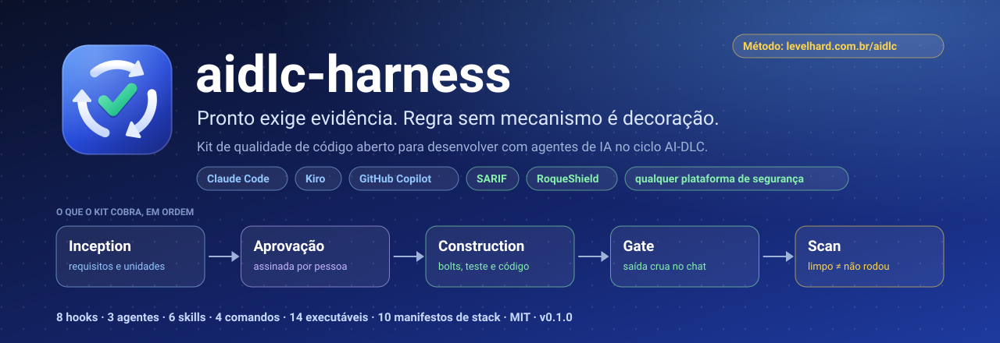
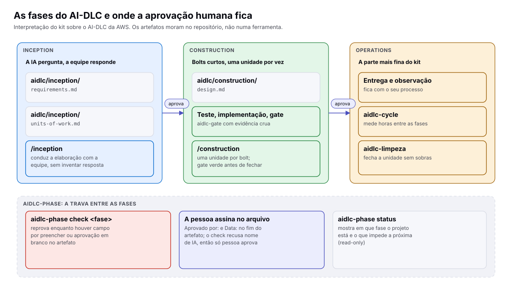

<p align="center">
  <a href="https://levelhard.com.br/aidlc">
    
  </a>
</p>

<p align="center">
  <a href="https://github.com/roqueribeiro/aidlc-harness/actions/workflows/ci.yml"></a>
  <a href="https://github.com/roqueribeiro/aidlc-harness/tags"></a>
  <a href="LICENSE"></a>
  <a href="docs/pt-BR/CONTRIBUTING.md#dco"></a>
  
  
  <a href="docs/pt-BR/FERRAMENTAS.md"></a>
</p>

<p align="center">
  <a href="docs/pt-BR/COMECAR.md"><b>Começar</b></a> ·
  <a href="docs/pt-BR/FERRAMENTAS.md"><b>Sua ferramenta de IA, passo a passo</b></a> ·
  <a href="docs/pt-BR/INDEX.md">Documentação</a> ·
  <a href="docs/pt-BR/REFERENCIA.md">Referência</a> ·
  <a href="https://levelhard.com.br/aidlc">O método na prática</a> ·
  <a href="README.md">English</a>
</p>

---

**O aidlc-harness leva um pedido de uma frase a requisitos aprovados e depois a código que só conta como pronto com evidência, dentro da ferramenta de IA que o time já usa.** A IA rascunha tudo com as recomendações dela e pergunta só o que não pode decidir, na janela de perguntas da própria ferramenta; uma pessoa aprova cada fase; e um gate recusa o "pronto" sem a saída crua dos testes. Funciona em **15 ferramentas de IA** (Claude Code, GitHub Copilot, Cursor, Kiro, OpenCode, Codex, Gemini CLI, Antigravity e outras) e em **10 stacks**, de Node a Java, .NET e Go.

> [!NOTE]
> **Versão 0.2, pré-lançamento.** Tudo o que está descrito aqui existe e tem teste, e o CI roda em Linux, macOS e Windows. Quais ferramentas de IA foram exercidas numa máquina de verdade está dito ferramenta por ferramenta em [Estado do projeto](#estado-do-projeto). Este projeto é uma interpretação prática do AI-DLC; não é documentação nem produto da AWS ([docs/pt-BR/AIDLC.md](docs/pt-BR/AIDLC.md)). Também em [inglês](README.md).

## Conteúdo

- [Começar em um minuto](#começar-em-um-minuto)
- [Sua ferramenta de IA](#sua-ferramenta-de-ia)
- [Uma Inception que não parece URA](#uma-inception-que-não-parece-ura)
- [Por que existe](#por-que-existe)
- [Como funciona](#como-funciona)
- [O que vem no kit](#o-que-vem-no-kit)
- [Segurança: qualquer plataforma, inclusive o RoqueShield](#segurança-qualquer-plataforma-inclusive-o-roqueshield)
- [Estado do projeto](#estado-do-projeto)
- [Limites conhecidos](#limites-conhecidos)
- [Documentação](#documentação)
- [Contribuir, segurança e licença](#contribuir-segurança-e-licença)
- [Idiomas](#idiomas)

## Começar em um minuto

Pré-requisitos: **Node 20.19 ou mais novo** e **git**. Na pasta do seu projeto:

```bash
npx github:roqueribeiro/aidlc-harness init
```

Num terminal, ele pergunta com quais ferramentas de IA o time trabalha (as que ele acha na pasta já vêm marcadas) e cria, para cada uma, os comandos no formato da própria ferramenta. Depois abra a sua ferramenta e rode a Inception com uma frase do que você quer, por exemplo `/aidlc-inception Quero um cadastro de clientes com busca e histórico de alterações`. O comando exato de cada ferramenta está na tabela abaixo e no `.aidlc/COMANDOS.md` do seu projeto.

É o único comando. Não há mais nada para instalar:

- **O kit se copia para o projeto** (`.aidlc/kit/`, versionado com o resto), e hooks, gate e fases rodam dessa cópia: `node .aidlc/kit/tools/aidlc-gate`. O colega que clona o repositório tem tudo funcionando.
- **O Claude Code carrega o plugin pelo projeto**: o `.claude/settings.json` registra o marketplace do kit, fixado nesta versão, e o plugin carrega quando você aceita o diálogo de confiança da pasta.
- **O Trivy vem sozinho**: o primeiro gate baixa a versão fixada no kit, conferida por sha256, para um cache.

O CI testa exatamente isso em Linux, macOS e Windows: uma máquina sem `aidlc` no `PATH` e com o home vazio, do `init` ao gate verde, e um clone novo. O caminho completo, com o que esperar em cada passo, está em **[docs/pt-BR/COMECAR.md](docs/pt-BR/COMECAR.md)**. Para ter também os comandos `aidlc-*` no `PATH` para outros projetos, o `npm install -g github:roqueribeiro/aidlc-harness` é opcional.

## Sua ferramenta de IA

Cada ferramenta recebe os comandos de Inception e Construction na pasta e no formato dela, e cada comando nomeia a janela de perguntas daquela ferramenta. Onde a ferramenta aceita hooks, o kit também segura um "pronto" que não tem gate verde por trás.

<!-- ferramentas:inicio -->
| Ferramenta | Comando | Janela de perguntas | Hooks do kit | Página |
| --- | --- | --- | --- | --- |
| Claude Code | `/inception` | `AskUserQuestion` | sim | [passo a passo](docs/pt-BR/ferramentas/claude.md) |
| OpenCode | `/aidlc-inception` | `question` | não | [passo a passo](docs/pt-BR/ferramentas/opencode.md) |
| Kilo Code | `/aidlc-inception` | `question` | não | [passo a passo](docs/pt-BR/ferramentas/kilo.md) |
| GitHub Copilot | `/aidlc-inception` (no VS Code; no Copilot CLI, peça a skill aidlc-inception) | `askQuestions` | sim | [passo a passo](docs/pt-BR/ferramentas/copilot.md) |
| Cursor | `/aidlc-inception` | `Ask questions` | sim | [passo a passo](docs/pt-BR/ferramentas/cursor.md) |
| Gemini CLI | `/aidlc:inception` | `ask_user` | não | [passo a passo](docs/pt-BR/ferramentas/gemini.md) |
| Google Antigravity | `/aidlc-inception` (a skill vira comando) | seletor de respostas | não | [passo a passo](docs/pt-BR/ferramentas/antigravity.md) |
| Kiro | `/aidlc-inception` (ou #aidlc-inception no chat) | não tem: texto com opções em letras | não | [passo a passo](docs/pt-BR/ferramentas/kiro.md) |
| OpenAI Codex | `$aidlc-inception` (depois de entrar no modo Plan com /plan) | `request_user_input` | sim | [passo a passo](docs/pt-BR/ferramentas/codex.md) |
| Devin Desktop (ex-Windsurf) | `/aidlc-inception` (a skill vira comando) | `ask_user_question` | não | [passo a passo](docs/pt-BR/ferramentas/devin.md) |
| Cline | `/aidlc-inception.md` | `ask_question` | não | [passo a passo](docs/pt-BR/ferramentas/cline.md) |
| JetBrains Junie | `/aidlc-inception` | `AskUserQuestion` | não | [passo a passo](docs/pt-BR/ferramentas/junie.md) |
| Continue | `/aidlc-inception` | `AskQuestion` | não | [passo a passo](docs/pt-BR/ferramentas/continue.md) |
| Augment (Auggie) | `/aidlc-inception` | não tem: texto com opções em letras | não | [passo a passo](docs/pt-BR/ferramentas/augment.md) |
| Zed | `/aidlc-inception` (a skill vira comando) | não tem: texto com opções em letras | não | [passo a passo](docs/pt-BR/ferramentas/zed.md) |
<!-- ferramentas:fim -->

Esta tabela é gerada dos mesmos adaptadores que o `aidlc-init` aplica, e o CI reprova se ela divergir. Onde o kit não tem hook, o CI cobra a evidência: o workflow `aidlc-gate.yml` que o `aidlc-init` cria roda em todo push, em qualquer ferramenta.

## Uma Inception que não parece URA

O jeito lento de levantar requisitos é fazer vinte perguntas antes de escrever qualquer coisa. O kit faz o contrário:

1. **Lê primeiro.** O `AGENTS.md`, o contexto do produto, as decisões já tomadas, o código e o que você puser em `aidlc/inception/insumos/` (transcrição de reunião, briefing, print). O que já está respondido ali não vira pergunta.
2. **Rascunha tudo.** Requisitos, histórias com critério de aceite verificável e unidades de trabalho, preenchidos com as recomendações da IA. Cada escolha que ela fez sozinha fica listada em **Premissas**, com o motivo.
3. **Pergunta só o que não pode decidir.** No máximo cinco perguntas, só sobre o que é irreversível, de negócio, de escopo, de compliance, de custo ou de nome, na janela de perguntas da ferramenta, com a opção recomendada primeiro. "Aceitar todas as recomendações" é sempre um clique (ou um "ok", onde não há janela).
4. **Uma pessoa aprova.** O `aidlc-phase check inception` reprova com mais de cinco perguntas em aberto, com premissa que ninguém revisou ou com aprovação assinada por uma IA.

O método mora num lugar só, a skill `aidlc-inception`, que todas as ferramentas leem. O texto completo está em [plugins/aidlc-harness/skills/aidlc-inception/SKILL.md](plugins/aidlc-harness/skills/aidlc-inception/SKILL.md).

## Por que existe

Um agente entrega, uma pessoa revisa, e acha o mesmo tipo de problema pela quinta vez. Não porque o modelo é ruim, mas porque cada sessão começa do zero, sem saber o que o time já decidiu e sem nada que cobre o "pronto". O gargalo vira a revisão.

O kit responde com quatro decisões que não são de prompt:

1. **Critério de aceite é dado, não prosa.** Um JSON por tecnologia diz qual comando roda, que saída reprova e se bloqueia.
2. **Determinismo vence o modelo quando a tarefa é mecânica.** Se um check pode ser script, ele é script.
3. **Evidência antes do "pronto".** A saída crua do gate, não um resumo.
4. **Uma pessoa aprova a fase.** O kit confere que a aprovação existe e não foi preenchida por uma IA.

Uma regra atravessa tudo: **regra sem mecanismo é decoração.** Cada norma deste repositório aponta o hook, o gate ou o manifesto que a executa ([docs/pt-BR/OPERATING-MODEL.md](docs/pt-BR/OPERATING-MODEL.md)).

## Como funciona

<picture>
  <source media="(prefers-color-scheme: dark)" srcset="docs/assets/diagramas/fases.escuro.svg">
  
</picture>

A equipe decide, a ferramenta de IA executa e o kit cobra o que foi combinado: instruções que todas as ferramentas leem (`AGENTS.md`), um comando por fase em cada ferramenta, executáveis `aidlc-*` que não gastam token, manifestos de qualidade por stack e, onde a ferramenta deixa, hooks. O `aidlc/decisions.md` guarda o que foi decidido e não se reabre. O desenho, com diagramas, está em **[docs/pt-BR/ARQUITETURA.md](docs/pt-BR/ARQUITETURA.md)**.

## O que vem no kit

| Peça | O que faz |
| --- | --- |
| `aidlc-init` | Prepara um projeto para as ferramentas escolhidas: `AGENTS.md` (um bloco gerenciado, se o time já tem um), comandos, skills, hooks, pastas do ciclo e um workflow de CI da stack detectada |
| `aidlc-phase` | Estado das fases; `check inception` reprova campo por preencher, mais de cinco perguntas em aberto, premissa sem revisão ou aprovação de IA |
| `aidlc-gate` | Roda o critério de aceite da stack detectada (Node com npm, yarn, pnpm ou bun, Python com uv, Java com Maven ou Gradle, .NET, Go) |
| `aidlc-hook` | Os hooks do kit no GitHub Copilot, no Cursor e no Codex: guarda de segredo e de gerenciador de pacote, e no fim do turno a conferência de que o gate está verde na árvore atual |
| `aidlc-doctor` | Dá nota ao repositório contra o padrão e diz o que falta, só para as ferramentas que o projeto usa |
| `aidlc-scan` | Lê o relatório de qualquer plataforma de segurança e separa **limpo** de **não rodou** |
| `aidlc-identity` | Varre IP, e-mail, caminho de home, hostname interno, segredo e os termos da sua lista |
| `aidlc-secrets`, `aidlc-secscan`, `aidlc-lockcheck` | Cofre que o agente usa sem ver, CVE com correção publicada, dependência fora do lockfile |
| `aidlc-mutation`, `aidlc-limpeza`, `aidlc-cycle`, `aidlc-graph`, `aidlc-harness` | Teste de mutação, bancada limpa, painel do ciclo, raio de impacto entre repositórios, custo de contexto |
| Plugin do Claude Code | Hooks que bloqueiam, agentes (`advisor`, `scanner`, `supply-chain-reviewer`), skills e os comandos `/inception`, `/construction`, `/gate`, `/status` |

A lista completa, com opções, campos e variáveis, está em [docs/pt-BR/REFERENCIA.md](docs/pt-BR/REFERENCIA.md). Um check do repositório reprova se algo existe no disco e não está listado lá.

## Segurança: qualquer plataforma, inclusive o RoqueShield

O kit não embute um scanner: ele **cobra o resultado de um**, com uma regra que não muda: *scan que não rodou não é scan limpo.* SARIF 2.1.0 (Semgrep, CodeQL, Trivy e outros), o formato neutro do kit e o AI Fix Bundle do [RoqueShield](docs/pt-BR/ROQUESHIELD.md) entram pelo mesmo contrato.

```console
$ aidlc-scan docs/exemplos/scan/neutro-nao-rodou.json; echo "saída $?"
aidlc-scan  docs/exemplos/scan/neutro-nao-rodou.json  (neutro; scanners: semgrep)
NAO RODOU: cobertura incompleta: algum scanner nao rodou ou falhou
saída 2
```

A lista de achados desse relatório está vazia, e mesmo assim o resultado **não** é limpo. Saída `0` é limpo, `1` reprovou, `2` não rodou. Detalhes em [docs/pt-BR/INTEGRACOES.md](docs/pt-BR/INTEGRACOES.md).

## Estado do projeto

| Item | Estado | Como foi medido |
| --- | --- | --- |
| Suíte de testes (`node --test`) | **504 passam, 0 falham** (1 pulado: só roda no Windows, no CI) | Linux, Node 22, 06/11/2026 |
| Integração contínua | verde em **Linux, macOS e Windows**, Node 20, 22 e 24 | GitHub Actions a cada push, com o teste de máquina limpa e o pacote instalado |
| Instalar com `npx github:…` e `npm install -g github:…` | funciona | rodado a partir do GitHub em 06/11/2026, e no CI a partir do pacote empacotado, nos três sistemas |
| Primeira execução sem nada instalado | `init`, hooks, fases e gate verde (Trivy baixado e conferido) a partir da cópia no projeto, e um clone novo | `scripts/primeira-execucao.test.mjs`, no CI em Linux, macOS e Windows, sem `aidlc` no `PATH` e com o home vazio |
| Gates das stacks novas | Go, bun, Maven, pnpm e yarn rodam verde e vermelho num projeto de verdade | Linux, 06/11/2026; Gradle só o vermelho (a rede bloqueou o verde); .NET não rodou |
| Mecanismos novos | cada um com um **mutante** que reprova | os testes de mutação ficam ao lado do código |
| As 15 ferramentas de IA numa máquina de verdade | **ainda não exercidas** | os arquivos e a janela de perguntas de cada uma foram conferidos na documentação oficial em 06/11/2026; os prints de sessões reais vão para `docs/compatibilidade/` |

Ainda não há promessa de compatibilidade entre versões menores.

## Limites conhecidos

- **Ferramentas de IA mudam todo mês.** O que cada página diz foi conferido em 06/11/2026 na documentação da ferramenta. Uma ferramenta só fica marcada como verificada com o print de uma sessão de verdade.
- **Há hooks no Claude Code, no GitHub Copilot, no Cursor e no Codex.** Nas outras ferramentas, quem segura um "pronto" sem prova é o CI e a revisão humana.
- **Kiro, Augment e Zed não têm janela de perguntas**: a Inception pergunta em texto curto, com opções em letras e a recomendada marcada.
- **O scanner de identidade acha formatos, não nomes.** O nome de uma pessoa, de um cliente ou de um sistema interno só é pego se estiver na sua lista de termos, que mora fora do repositório.
- **O `aidlc-phase` confere a forma, não a verdade.** Ele garante que a aprovação existe e não é de uma IA; se o nome é de quem aprovou de fato, é revisão humana.
- **As mensagens do próprio kit estão em português do Brasil** (executáveis, hooks, prompts). A documentação está em inglês e em português do Brasil.

## Documentação

Comece por **[docs/pt-BR/COMECAR.md](docs/pt-BR/COMECAR.md)** e **[docs/pt-BR/FERRAMENTAS.md](docs/pt-BR/FERRAMENTAS.md)**. O mapa completo está em [docs/pt-BR/INDEX.md](docs/pt-BR/INDEX.md):

| Documento | Para quê |
| --- | --- |
| [FERRAMENTAS](docs/pt-BR/FERRAMENTAS.md) | Cada ferramenta de IA, passo a passo |
| [ARQUITETURA](docs/pt-BR/ARQUITETURA.md) | Como é construído por dentro, com diagramas |
| [REFERENCIA](docs/pt-BR/REFERENCIA.md) | Cada executável, hook, comando, campo e variável |
| [AIDLC](docs/pt-BR/AIDLC.md) | O método e como o kit o interpreta |
| [ADAPTADORES](docs/pt-BR/ADAPTADORES.md) | O que cada ferramenta recebe, instrução versus mecanismo |
| [REGULADO](docs/pt-BR/REGULADO.md) | Perfil para empresa regulada |
| [INTEGRACOES](docs/pt-BR/INTEGRACOES.md) | Plataformas de segurança, CI e ferramentas de IA |
| [QUANDO-QUEBRA](docs/pt-BR/QUANDO-QUEBRA.md) | O que cada resultado do gate quer dizer |

O método por trás do kit, em linguagem simples, está em **[levelhard.com.br/aidlc](https://levelhard.com.br/aidlc)**.

## Contribuir, segurança e licença

- **Contribuir:** [docs/pt-BR/CONTRIBUTING.md](docs/pt-BR/CONTRIBUTING.md). Todo check novo vem com um mutante, e os commits são assinados com `git commit -s` ([DCO](docs/pt-BR/CONTRIBUTING.md#dco)). Relato de sessão de verdade em cada ferramenta de IA é a contribuição mais útil agora.
- **Segurança:** relate vulnerabilidades em privado, como diz o [SECURITY.md](SECURITY.md).
- **Conduta:** [CODE_OF_CONDUCT.md](CODE_OF_CONDUCT.md).
- **Licença:** [MIT](LICENSE).

## Idiomas

O inglês é o idioma principal deste repositório, e cada documento tem um par em português do Brasil: este arquivo e [docs/pt-BR/](docs/pt-BR/INDEX.md). Se os dois divergirem, vale o inglês, e o `check-i18n` reprova o CI quando um par fica para trás. O próprio kit fala português do Brasil (mensagens dos executáveis, hooks, prompts e comandos).
