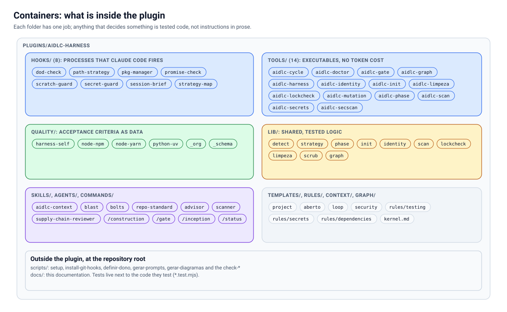
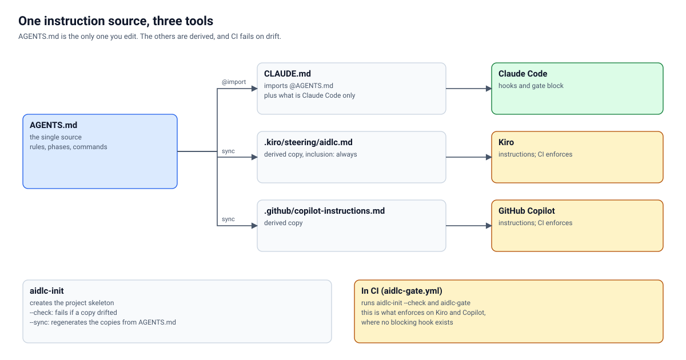

# Architecture

*Also available in [Brazilian Portuguese](pt-BR/ARQUITETURA.md).*

> How `aidlc-harness` is built inside: the parts, how they talk to each other, where each decision lives and what happens when something goes wrong. For those who will adopt, extend or contribute. The numbers in the diagrams are read from disk by `scripts/gerar-diagramas.mjs`, so they do not go stale on their own.
>
> This document describes the design. For every command, field and variable, see the [REFERENCE](REFERENCE.md); for the reasoning behind the choices, the [STRATEGY](STRATEGY.md).

## Table of contents

1. [The idea in one paragraph](#1-the-idea-in-one-paragraph)
2. [Context: where the kit fits in](#2-context-where-the-kit-fits-in)
3. [Containers: what is inside the plugin](#3-containers-what-is-inside-the-plugin)
4. [Acceptance criteria as data](#4-acceptance-criteria-as-data)
5. [The path of an edit: hooks in order](#5-the-path-of-an-edit-hooks-in-order)
6. [Stop: how "done" earns evidence](#6-stop-how-done-earns-evidence)
7. [Phases and human approval](#7-phases-and-human-approval)
8. [One source of instructions, three tools](#8-one-source-of-instructions-three-tools)
9. [Security: the scan contract](#9-security-the-scan-contract)
10. [Principles that run through the code](#10-principles-that-run-through-the-code)
11. [Security of the kit itself](#11-security-of-the-kit-itself)
12. [Design decisions](#12-design-decisions)
13. [Extension points](#13-extension-points)
14. [Known limits](#14-known-limits)
15. [How the diagrams are made](#15-how-the-diagrams-are-made)

---

## 1. The idea in one paragraph

AI agents generate code cheaply; checking it is expensive. The kit moves the checking from the prompt to the **tooling**: the acceptance criteria of each technology is an executable JSON file, the agent may only say "done" after pasting the raw gate output into the chat (a `Stop` hook refuses to end the turn without it), and each phase of the cycle is approved by a person, whose signature a command checks. None of this depends on a model to decide: whatever can be a script is a script.

## 2. Context: where the kit fits in


Three actors and one boundary:

- **The team** decides what to build and **signs** the approval of each phase in the artifact itself.
- **The AI tool** (Claude Code, Kiro or GitHub Copilot) executes. It reads the repository's instructions; only in Claude Code are there hooks that actually **block**.
- **The kit** is what enforces. It does not write product code: it delivers the rule at the right moment, runs the acceptance criteria and refuses "done" without evidence.

On the outside, the **security platforms** (RoqueShield, any tool that exports SARIF, the embedded Trivy) come in through a single contract, [`aidlc-scan`](#9-security-the-scan-contract). The kit does not embed a scanner: it demands the result of one. See [ROQUESHIELD.md](ROQUESHIELD.md) and [INTEGRATIONS.md](INTEGRATIONS.md).

## 3. Containers: what is inside the plugin



| Folder | Role | Golden rule |
| --- | --- | --- |
| `hooks/` | Processes that Claude Code fires per event | Fail toward **letting work proceed** |
| `tools/` | `aidlc-*` executables, zero token cost | Exit 0, 1 or 2, never ambiguous |
| `lib/` | Shared, tested logic (detection, strategy, phases, scan, identity) | Every decision rule lives here, with a test, not in the executable |
| `quality/` | The acceptance criteria as data | Validated by schema; an invalid one is ignored and reported |
| `skills/`, `agents/`, `commands/` | Instructions for the agent | They only guide; whatever is verifiable becomes an executable |
| `templates/` | What `aidlc-init` copies into the project | Parameterized by name and tools |
| `rules/`, `context/`, `graph/` | On-demand rules, product context, example graph | Delivered by `path-strategy`, not auto-loaded |

The **thin executable, thick lib** split exists for testing: the executable only reads arguments and prints; the decision (`avalia`, `conferirFase`, `varrer`) is a pure function that the suite exercises with synthetic inputs.

## 4. Acceptance criteria as data


A manifest says **how to recognize** the technology, **what to run**, **what must show up in the chat** and **what to read before writing**. The same file feeds four consumers: `aidlc-gate` (runs the gates), `session-brief` (announces), `path-strategy` (delivers the rule for the file) and `dod-check` (demands the evidence).

**Resolution.** `detectTech` reads the folder contents (`allFiles` is AND, `anyFiles` is OR, `packageDeps` looks at `package.json`) and picks the manifest with the highest `priority` that matches. Detecting by content, not by folder name, is what makes the kit work in a repository that nobody renamed for it.

**Layers.** Three, from the most general to the most specific:

1. **Kit** (`plugins/aidlc-harness/quality/`): what holds for the stack anywhere.
2. **Organization** (`quality/_org.json`): gates and evidence that hold for **every** stack matching a `when`, written once. Copying the same gate into several files is the fastest way to diverge silently, which is why a literal copy of an inherited gate fails the check.
3. **Project** (`.aidlc/quality/<tech>.json`): a manifest with the same `tech` **overrides** the kit's. This is how a team tightens or loosens the criteria without forking.

A gate declares `blocking` (it fails `aidlc-gate`), `cmd` or `agent` (a reviewer, mutually exclusive) and `$why`: the real defect that made it exist. A gate without a written reason is the first one someone removes when it gets in the way.

**Platform honesty.** A `platform: darwin` gate running on Linux comes out **SKIPPED**, never green. The same goes for `aidlc-doctor`. Green only exists when something ran and passed.

## 5. The path of an edit: hooks in order


The design bets on speaking **at the moment each piece of information costs least and is worth most**:

- **`SessionStart`** (`session-brief`): once, short. States the stack, the gates and the phase. It enters every session, so each line is paid for many times.
- **`UserPromptSubmit`** (`strategy-map`): on every prompt. It is the channel that survives `/compact`, when `SessionStart` no longer comes back. Full map on the first prompt and every 8th; a short line on the rest.
- **`PreToolUse`** (`scratch-guard`, `pkg-manager`, `secret-guard`): before the command or the write. It is the only point where you can **prevent** instead of regret. Exit 2 blocks and states the right path.
- **`PostToolUse`** (`path-strategy`): the file has just changed, and this is the only instant at which the kit knows for certain which piece of the system is being built. It delivers the rule for that path, once per session.
- **`Stop`** (`promise-check`, `dod-check`): the agent wants to stop. This is where evidence is demanded.

**State between hooks.** Each hook is a new process with no memory. The little that must persist (which pointers were already delivered, how many refusals Stop has already issued) goes into a file in `os.tmpdir()` keyed by the session id (`aidlc-strategy-<session>.json`, `aidlc-dod-<session>.json`). Losing that file repeats one line of context; it never breaks anything.

**Cost.** `Edit` hooks fire dozens of times per session. Hence: no model, no `git` on the hot path, no repeating the same line. A hook that burns a turn is the first one someone turns off.

## 6. Stop: how "done" earns evidence


`dod-check` reads the tree (`git status`), the manifest and the transcript, and decides in milliseconds:

1. Nothing changed in the tree → allows (there was no delivery to prove), **unless** the last turn claims to close a unit of work: then only the `whenSays` evidence is demanded.
2. Technology not recognized → allows.
3. All the evidence's `markers` appear in the turn → allows.
4. Something is missing → **refuses** to end the turn and lists what is missing (gate output, screenshot, reviewer verdict). The agent keeps working instead of handing the problem back.

**Safeguards so it never becomes a prison.** After 3 refusals in the same session the gate becomes a warning and allows; `gate_mode` accepts `block`, `warn` and `off`; `AIDLC_GATE=0` turns everything off; and failing to write the audit record never holds Stop. The reason is practical: a gate that traps gets turned off in the first week. The design bets on demanding little, always, and leaving an exit.

Each decision becomes a line in `.claude/audit/<day>.jsonl`, and `aidlc-cycle` computes the block rate and the time in gate from it.

## 7. Phases and human approval


`aidlc-phase check <phase>` is the lock. A phase is complete when every file exists, does not have the `<!-- PREENCHER` marker and ends with `Aprovado por:` and `Data:` filled in (these are the literal labels the check looks for, in Portuguese). The name is **refused** if it belongs to an AI tool, so the agent cannot approve its own work. Construction requires a complete Inception.

What the lock **proves** is the form: it exists, it is filled in, it has a name and a date that are not an AI's. What it **does not prove** is that the content is right or that the name belongs to someone with authority. That is for the organization's process (for example, mandatory pull request review of the commit that carries the signature). The kit says this in its output and in the documentation so that nobody confuses "signed" with "reviewed". See [AIDLC.md](AIDLC.md).

The **Operations** phase is the thinnest in the kit: delivery and observation are left to your process; the kit offers `aidlc-cycle` (measure) and `aidlc-limpeza` (close the unit of work with no leftovers).

## 8. One source of instructions, three tools



`AGENTS.md` is the only instruction file you edit. `CLAUDE.md` imports it (`@AGENTS.md`) and adds only what belongs to Claude Code; the copies for Kiro (`.kiro/steering/aidlc.md`) and Copilot (`.github/copilot-instructions.md`) are **derived** by `aidlc-init --sync`, and `aidlc-init --check` in CI fails on divergence.

The difference that matters is **instruction versus mechanism**:

| | Claude Code | Kiro | GitHub Copilot |
| --- | --- | --- | --- |
| Project instructions | yes | yes | yes |
| Hooks that block (evidence at Stop, secret, package manager) | **yes** | no | no |
| `aidlc-*` executables | yes | yes | yes |
| Gate in CI | yes | yes | yes |

In Kiro and Copilot, what plays the role of the hooks is **CI** (`aidlc-gate.yml`) and human review. This is a limit, stated in the [REFERENCE](REFERENCE.md) and in [ADAPTERS.md](ADAPTERS.md), not a detail to discover later.

## 9. Security: the scan contract


The rule that organizes the module: **a scan that did not run is not a clean scan.** An empty report can mean "nothing found" or "the scanner crashed", and the two are indistinguishable if the gate only counts findings. That is why `aidlc-scan` has three outcomes, not two (0 clean, 1 failed, 2 did not run).

The flow (`lib/scan.mjs`, function `avalia`):

1. **Normalize.** Each format becomes `{ formato, coberturaCompleta: true|false|null, scanners, achados }`. `null` means "the report does not say", and it is treated as **did not run**.
2. **Check coverage.** Incomplete, unknown or with a required scanner missing → exit 2. With `--baseline`, the baseline must also have complete coverage, and a scanner that ran before and is now gone counts as "did not run".
3. **Apply the threshold.** A finding at the `--fail-on` severity (default `high`) or above → exit 1.

Because it is a **report reader**, not an API client, any platform that exports SARIF 2.1.0 or the neutral format comes in with no new code, and RoqueShield comes in through the AI Fix Bundle. The dangerous side of accepting many formats is reading coverage where none exists; that is why each reader decides `coberturaCompleta` with its own rule and the suite has mutants for each one (coverage `false` ignored, `null` treated as complete, SARIF without `runs` treated as complete, baseline with a missing scanner, `>=` swapped for `>`).

## 10. Principles that run through the code

1. **A rule without a mechanism is decoration.** Before proposing a norm, you say which hook, gate or manifest enforces it. The norms of this repository point to the mechanism ([../OPERATING-MODEL.md](../OPERATING-MODEL.md)).
2. **Every check is born with a mutant.** You break the code on purpose and confirm that the test fails. A check that never failed is not a check. The tests have explicit `mutante:` cases.
3. **Fail toward letting work proceed.** A hook that is unsure exits with 0. Blocking by mistake costs more than letting one case through.
4. **Three states, not two.** Passed, failed and **did not run** are different things (`PULADO`, `PENDENTE`, exit 2). Faked green is the defect the kit fights most.
5. **Determinism before models.** Whatever can be a script is a script; a model only where there is judgment (reviewer, advisor).
6. **Raw evidence.** The gate output is pasted in the chat, not summarized. A summary is interpretation.
7. **No runtime dependency.** The kit is plain Node: there is no `npm install` or `yarn install` for the kit itself.
8. **Where the number changes, it is measured.** Counts in documents and diagrams are checked against disk (`check-docs-consistency`, `gerar-diagramas --check`, `check-reference`).

## 11. Security of the kit itself

The kit runs code on the machine of whoever installs it and reads the transcript, so the surface deserves explicit writing.

| Risk | How the kit handles it | Mechanism |
| --- | --- | --- |
| A hook executes arbitrary `node` | Small code, no runtime dependency, open and tested; the plugin is installed from a marketplace you choose and can audit | Hook suite; `claude plugin validate --strict` |
| A printed secret becomes a permanent record (synced transcript) | `secret-guard` blocks the command that would print it; `aidlc-secrets exec` injects it into the child's environment | `hooks/secret-guard.mjs`, tests |
| A dependency invented by the model (a name someone registers first) | `aidlc-lockcheck` requires every dependency to be in the lockfile; `supply-chain-reviewer` judges reputation | `lockfile` gate in the organization layer |
| CI pulls the kit from `main` and it changes without notice | The generated workflow pins the kit at `AIDLC_REF` (tag or commit) | `templates/project/aidlc-gate.yml` |
| Personal or infrastructure data enters the repository | `aidlc-identity` scans formats and a list of terms that stays **outside** the repository | The kit's own `identity` gate |
| A fork PR runs code with a secret | CI runs on `pull_request` with no secret; `aidlc-doctor` checks | Doctor check for an open repository |
| A phase approval filled in by the AI | `aidlc-phase check` refuses the name of an AI tool | `lib/phase.mjs`, tests |

What the kit does **not** protect: an agent with shell access can, by definition, do things that no hook anticipated, and `secret-guard` is a set of patterns, not a sandbox. It reduces the common accident; it does not replace least privilege or review. To report a vulnerability in the kit, see [../SECURITY.md](../SECURITY.md).

## 12. Design decisions

| Decision | Discarded alternative | Why |
| --- | --- | --- |
| JSON manifest validated by schema | Prose in `CLAUDE.md` | "Run the tests" is open to interpretation; a JSON with the command, the output that fails and whether it blocks is executable |
| Detect the stack by content | By folder name or manual configuration | Works in a repository that nobody renamed; no setup step |
| Hooks without a model | An agent-type hook to judge "done" | A model-based DoD check cost seconds per turn and varied; the deterministic one does the same in milliseconds |
| Cap of 3 refusals at Stop | Refuse until there is evidence | A gate that traps gets turned off in the first week |
| `AGENTS.md` as the source, derived copies | Maintain three files by hand | Three files diverge; one plus `--check` does not |
| `aidlc-scan` reads a report | An API client for each platform | Any platform comes in without code; no credential in the kit; the contract is what matters |
| Exit 2 for "did not run" | Treat an empty report as clean | It is exactly the defect the contract exists to prevent |
| Identity allowlist with mandatory `why` | Free-form allowlist | Accepting a finding is a decision with a reason, not filing it away |
| Diagrams as code with a text lock | A diagram tool with automatic layout | Coordinates are the drawer's decision; the lock prevents clipped text; `--check` prevents a stale diagram |
| Kit with no runtime dependency | Third-party libraries | Less supply chain surface in a kit that exists to control it |

## 13. Extension points

The kit is made to be extended **without a fork**. The paths, from least to most effort:

- **Adjust the criteria of a stack in your project:** `.aidlc/quality/<tech>.json` with the same `tech` overrides the kit's.
- **Apply a rule to every stack in the organization:** `quality/_org.json` (organization layer), with `when`.
- **Add a technology:** a new `quality/<tech>.json` and a `strategy` cut. The step by step, and which check enforces each step, is in [EXTENDING.md](EXTENDING.md).
- **Plug in a security platform:** export the report (SARIF, neutral or RoqueShield) and call `aidlc-scan` as a gate. See [INTEGRATIONS.md](INTEGRATIONS.md) and `templates/security/node-yarn-com-scan.json`.
- **Add a reviewer:** an agent in `agents/` and an `agent` gate in the manifest.
- **Add a hook:** a `.mjs` in `hooks/`, registered in `hooks.json`, with a test that it fails toward allowing. `check-plugin` verifies the registration.
- **Your organization's internal layer:** keep it **in another repository**, private, with your manifests, forbidden terms and internal rules, pointing at this kit. Nothing that identifies a person, company or infrastructure comes back here ([REGULATED.md](REGULATED.md)).

## 14. Known limits

- **Verified:** Linux, Node 22. The suite covers hooks, phases, the identity scanner, `aidlc-init`, installation, manifests, the scan contract and diagram generation, with mutants.
- **Not verified on a real machine:** macOS, Windows, Kiro, GitHub Copilot, and the Node 20.19 floor (only 22 was run). The Kiro and Copilot file conventions were checked against the public documentation, and documentation changes.
- **Hooks only in Claude Code.** In Kiro and Copilot, CI is what enforces.
- **The RoqueShield integration was validated against its documentation**, not against a running instance ([ROQUESHIELD.md](ROQUESHIELD.md)).
- **`aidlc-phase` checks form, not truth**; `aidlc-identity` finds formats, not names; `secret-guard` is patterns, not a sandbox.
- **The Operations phase is the thinnest.** AI-DLC is more about Inception and Construction; the kit follows.
- **This project is a practical interpretation of AI-DLC**, not AWS documentation or an AWS product.

## 15. How the diagrams are made

The SVGs in `docs/assets/diagramas/` (a light and a dark one per diagram) are **generated**, not drawn by hand:

```bash
node scripts/gerar-diagramas.mjs          # writes the SVGs
node scripts/gerar-diagramas.mjs --check  # fails if the versioned SVG differs from what the code generates
```

- The diagram code is in `scripts/diagramas/` (`lib.mjs` is a minimal DSL; `diagramas.mjs` draws).
- Each coordinate is the drawer's decision, and the drawing comes out identical every time; that is why `--check` can tell that an SVG fell behind.
- `caixa` **measures the text and throws an error** if it does not fit: a diagram with clipped text is not generated.
- The numbers (how many hooks, executables, manifests) come from the disk inventory, not from hand-written text.
- In documents, use `<picture>` for the light and dark theme when the image is the main point:

```html
<picture>
  <source media="(prefers-color-scheme: dark)" srcset="en/docs/assets/diagramas/contexto.escuro.svg">
  
</picture>
```
