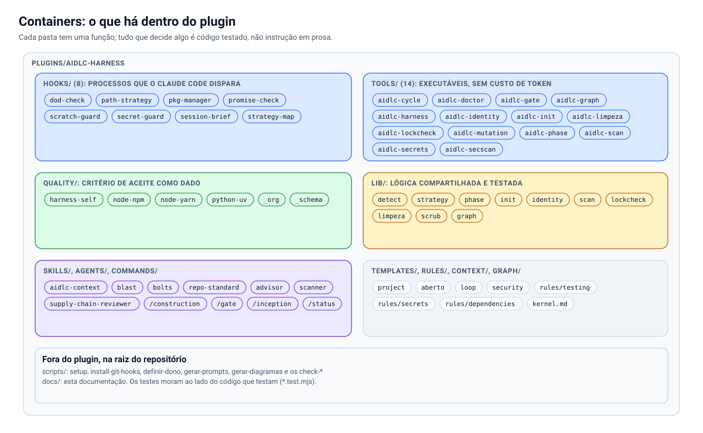
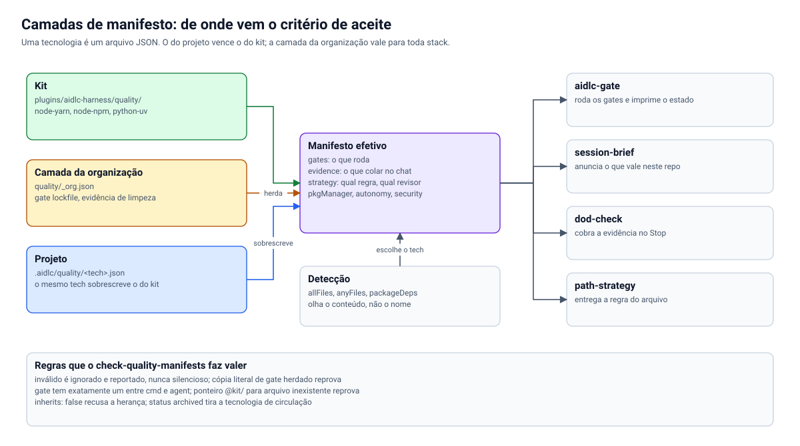
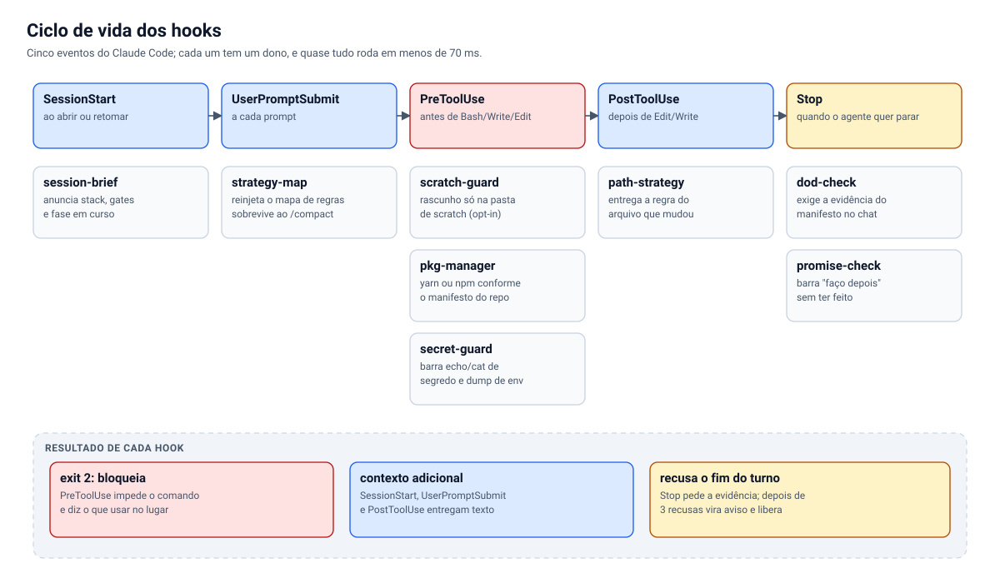
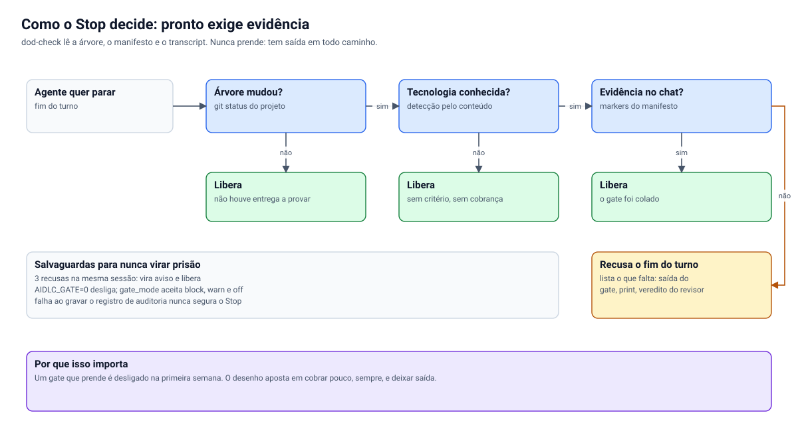
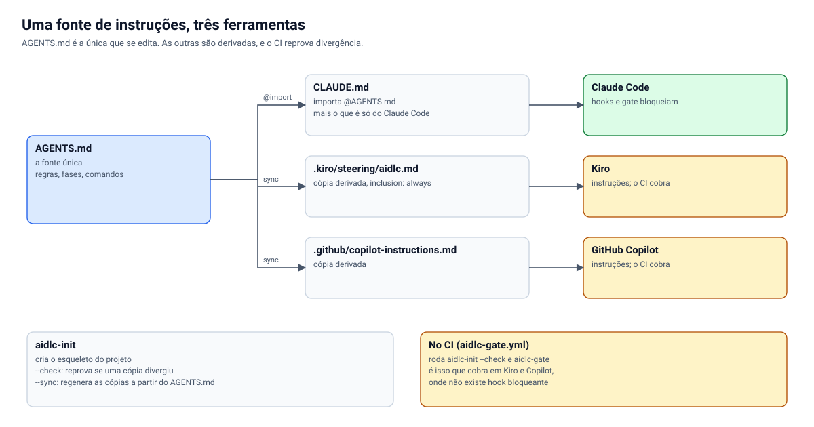

# Arquitetura

> Como o `aidlc-harness` é feito por dentro: as peças, como conversam, onde cada decisão mora e o que acontece quando algo dá errado. Para quem vai adotar, estender ou contribuir. Os números dos diagramas são lidos do disco por `scripts/gerar-diagramas.mjs`, então não envelhecem sozinhos.
>
> Este documento descreve o desenho. Para cada comando, campo e variável, veja a [REFERÊNCIA](REFERENCIA.md); para o raciocínio por trás das escolhas, a [ESTRATÉGIA](ESTRATEGIA.md).

## Sumário

1. [A ideia em um parágrafo](#1-a-ideia-em-um-parágrafo)
2. [Contexto: onde o kit entra](#2-contexto-onde-o-kit-entra)
3. [Containers: o que há dentro do plugin](#3-containers-o-que-há-dentro-do-plugin)
4. [O critério de aceite como dado](#4-o-critério-de-aceite-como-dado)
5. [O caminho de uma edição: hooks em ordem](#5-o-caminho-de-uma-edição-hooks-em-ordem)
6. [O Stop: como "pronto" ganha evidência](#6-o-stop-como-pronto-ganha-evidência)
7. [As fases e a aprovação humana](#7-as-fases-e-a-aprovação-humana)
8. [Uma fonte de instruções, três ferramentas](#8-uma-fonte-de-instruções-três-ferramentas)
9. [Segurança: o contrato de varredura](#9-segurança-o-contrato-de-varredura)
10. [Princípios que atravessam o código](#10-princípios-que-atravessam-o-código)
11. [Segurança do próprio kit](#11-segurança-do-próprio-kit)
12. [Decisões de desenho](#12-decisões-de-desenho)
13. [Pontos de extensão](#13-pontos-de-extensão)
14. [Limites conhecidos](#14-limites-conhecidos)
15. [Como os diagramas são feitos](#15-como-os-diagramas-são-feitos)

---

## 1. A ideia em um parágrafo

Agente de IA gera código barato; conferir é caro. O kit move a conferência do prompt para o **tooling**: o critério de aceite de cada tecnologia é um arquivo JSON executável, o agente só pode dizer "pronto" depois de colar a saída crua do gate no chat (um hook de `Stop` recusa o fim do turno sem ela), e quem aprova cada fase do ciclo é uma pessoa, cuja assinatura um comando confere. Nada disso depende de modelo para decidir: o que dá para ser script é script.

## 2. Contexto: onde o kit entra


Três atores e uma fronteira:

- **A equipe** decide o que construir e **assina** a aprovação de cada fase no próprio artefato.
- **A ferramenta de IA** (Claude Code, Kiro ou GitHub Copilot) executa. Ela lê as instruções do repositório; só no Claude Code há hooks que **bloqueiam** de fato.
- **O kit** é o que cobra. Ele não escreve código do produto: entrega regra no momento certo, roda o critério de aceite e recusa o "pronto" sem evidência.

Do lado de fora, as **plataformas de segurança** (RoqueShield, qualquer ferramenta que exporte SARIF, o Trivy embutido) entram por um único contrato, o [`aidlc-scan`](#9-segurança-o-contrato-de-varredura). O kit não embute um scanner: cobra o resultado de um. Veja [ROQUESHIELD.md](ROQUESHIELD.md) e [INTEGRACOES.md](INTEGRACOES.md).

## 3. Containers: o que há dentro do plugin



| Pasta | Papel | Regra de ouro |
| --- | --- | --- |
| `hooks/` | Processos que o Claude Code dispara por evento | Falham para o lado de **deixar trabalhar** |
| `tools/` | Executáveis `aidlc-*`, sem custo de token | Saída 0, 1 ou 2, nunca ambígua |
| `lib/` | Lógica compartilhada e testada (detecção, estratégia, fases, scan, identidade) | Toda regra de decisão mora aqui, com teste, não no executável |
| `quality/` | O critério de aceite como dado | Validado por schema; inválido é ignorado e reportado |
| `skills/`, `agents/`, `commands/` | Instruções para o agente | Só orientam; o que é verificável vira executável |
| `templates/` | O que o `aidlc-init` copia para o projeto | Parametrizado por nome e ferramentas |
| `rules/`, `context/`, `graph/` | Regras lidas sob demanda, contexto de produto, exemplo de grafo | Entregues pelo `path-strategy`, não auto-carregadas |

A separação **executável fino, lib grossa** existe para o teste: o executável só lê argumentos e imprime; a decisão (`avalia`, `conferirFase`, `varrer`) é função pura que a suíte exercita com entradas sintéticas.

## 4. O critério de aceite como dado



Um manifesto diz **como reconhecer** a tecnologia, **o que rodar**, **o que precisa aparecer no chat** e **o que ler antes de escrever**. O mesmo arquivo alimenta quatro consumidores: `aidlc-gate` (roda os gates), `session-brief` (anuncia), `path-strategy` (entrega a regra do arquivo) e `dod-check` (cobra a evidência).

**Resolução.** `detectTech` lê o conteúdo da pasta (`allFiles` é E, `anyFiles` é OU, `packageDeps` olha o `package.json`) e escolhe o manifesto de maior `priority` que casa. Detectar pelo conteúdo, e não pelo nome da pasta, é o que faz o kit funcionar num repositório que ninguém renomeou para ele.

**Camadas.** Três, da mais geral à mais específica:

1. **Kit** (`plugins/aidlc-harness/quality/`): o que vale para a stack em qualquer lugar.
2. **Organização** (`quality/_org.json`): gates e evidências que valem para **toda** stack que casa um `when`, escritos uma vez. Copiar o mesmo gate em vários arquivos é o jeito mais rápido de divergir calado, por isso a cópia literal de um gate herdado reprova no check.
3. **Projeto** (`.aidlc/quality/<tech>.json`): um manifesto com o mesmo `tech` **sobrescreve** o do kit. É assim que um time aperta ou afrouxa o critério sem fazer fork.

Um gate declara `blocking` (reprova o `aidlc-gate`), `cmd` ou `agent` (um revisor, exclusivos), e `$why`: o defeito real que o fez existir. Gate sem motivo escrito é o primeiro que alguém remove quando incomoda.

**Honestidade da plataforma.** Um gate de `platform: darwin` rodando em Linux sai **PULADO**, nunca verde. O mesmo vale para o `aidlc-doctor`. Verde só existe quando algo rodou e passou.

## 5. O caminho de uma edição: hooks em ordem



O desenho aposta em falar **no momento em que cada informação custa menos e vale mais**:

- **`SessionStart`** (`session-brief`): uma vez, curto. Diz a stack, os gates e a fase. Entra em toda sessão, então cada linha é paga muitas vezes.
- **`UserPromptSubmit`** (`strategy-map`): a cada prompt. É o canal que sobrevive ao `/compact`, quando o `SessionStart` já não volta. Mapa completo no primeiro prompt e a cada 8; linha curta nos demais.
- **`PreToolUse`** (`scratch-guard`, `pkg-manager`, `secret-guard`): antes do comando ou da escrita. É o único ponto em que dá para **impedir** em vez de lamentar. Saída 2 bloqueia e diz o caminho certo.
- **`PostToolUse`** (`path-strategy`): o arquivo acabou de mudar, e esse é o único instante em que o kit sabe com certeza qual pedaço do sistema está sendo construído. Entrega a regra daquele caminho, uma vez por sessão.
- **`Stop`** (`promise-check`, `dod-check`): o agente quer parar. Aqui se cobra a evidência.

**Estado entre hooks.** Cada hook é um processo novo, sem memória. O pouco que precisa persistir (quais ponteiros já foram entregues, quantas recusas o Stop já deu) vai para um arquivo em `os.tmpdir()` chaveado pelo id da sessão (`aidlc-strategy-<sessão>.json`, `aidlc-dod-<sessão>.json`). Perder esse arquivo repete uma linha de contexto; nunca quebra nada.

**Custo.** Hooks de `Edit` disparam dezenas de vezes por sessão. Por isso: nada de modelo, nada de `git` no caminho quente, nada de repetir a mesma linha. Um hook que gasta turno é o primeiro que alguém desliga.

## 6. O Stop: como "pronto" ganha evidência



O `dod-check` lê a árvore (`git status`), o manifesto e o transcript, e decide em milissegundos:

1. Nada mudou na árvore → libera (não houve entrega a provar), **salvo** quando o último turno afirma fechar uma unidade de trabalho: aí só a evidência `whenSays` é cobrada.
2. Tecnologia não reconhecida → libera.
3. Todos os `markers` da evidência aparecem no turno → libera.
4. Falta algo → **recusa** o fim do turno e lista o que falta (saída do gate, print, veredito do revisor). O agente continua trabalhando em vez de devolver o problema.

**Salvaguardas para nunca virar prisão.** Depois de 3 recusas na mesma sessão o gate vira aviso e libera; `gate_mode` aceita `block`, `warn` e `off`; `AIDLC_GATE=0` desliga tudo; e falhar ao gravar o registro de auditoria nunca segura o Stop. A razão é prática: um gate que prende é desligado na primeira semana. O desenho aposta em cobrar pouco, sempre, e deixar saída.

Cada decisão vira uma linha em `.claude/audit/<dia>.jsonl`, e `aidlc-cycle` calcula daí a taxa de bloqueio e o tempo em gate.

## 7. As fases e a aprovação humana


`aidlc-phase check <fase>` é a trava. Uma fase está completa quando cada arquivo existe, não tem o marcador `<!-- PREENCHER` e termina com `Aprovado por:` e `Data:` preenchidos. O nome é **recusado** se for de ferramenta de IA, para o agente não aprovar o próprio trabalho. A Construction exige a Inception completa.

O que a trava **prova** é a forma: existe, está preenchido, tem nome e data que não são de uma IA. O que ela **não prova** é que o conteúdo está certo nem que o nome é de quem tem autoridade. Isso é do processo da organização (por exemplo, revisão obrigatória do pull request que comita a assinatura). O kit diz isso na saída e na documentação para ninguém confundir "assinado" com "revisado". Veja [AIDLC.md](AIDLC.md).

A fase **Operations** é a mais fina do kit: entrega e observação ficam com o seu processo; o kit oferece `aidlc-cycle` (medir) e `aidlc-limpeza` (fechar a unidade sem sobras).

## 8. Uma fonte de instruções, três ferramentas



`AGENTS.md` é o único arquivo de instrução que se edita. `CLAUDE.md` o importa (`@AGENTS.md`) e acrescenta só o que é do Claude Code; as cópias para Kiro (`.kiro/steering/aidlc.md`) e Copilot (`.github/copilot-instructions.md`) são **derivadas** por `aidlc-init --sync`, e `aidlc-init --check` no CI reprova divergência.

A diferença que importa é **instrução versus mecanismo**:

| | Claude Code | Kiro | GitHub Copilot |
| --- | --- | --- | --- |
| Instruções do projeto | sim | sim | sim |
| Hooks que bloqueiam (evidência no Stop, segredo, gerenciador) | **sim** | não | não |
| Executáveis `aidlc-*` | sim | sim | sim |
| Gate no CI | sim | sim | sim |

Em Kiro e Copilot, o que faz o papel dos hooks é o **CI** (`aidlc-gate.yml`) e a revisão humana. Isso é um limite, dito na [REFERÊNCIA](REFERENCIA.md) e no [ADAPTADORES.md](ADAPTADORES.md), não um detalhe a descobrir depois.

## 9. Segurança: o contrato de varredura


A regra que organiza o módulo: **um scan que não rodou não é um scan limpo.** Um relatório vazio pode significar "nada achado" ou "o scanner caiu", e as duas coisas são indistinguíveis se o gate só conta achados. Por isso `aidlc-scan` tem três resultados, não dois (0 limpo, 1 reprovado, 2 não rodou).

O fluxo (`lib/scan.mjs`, função `avalia`):

1. **Normaliza.** Cada formato vira `{ formato, coberturaCompleta: true|false|null, scanners, achados }`. `null` significa "o relatório não diz", e é tratado como **não rodou**.
2. **Confere a cobertura.** Incompleta, desconhecida ou com scanner exigido ausente → saída 2. Com `--baseline`, o baseline também precisa ter cobertura completa, e um scanner que rodou antes e sumiu agora é "não rodou".
3. **Aplica o limite.** Achado na severidade de `--fail-on` (padrão `high`) ou acima → saída 1.

Como é um **leitor de relatório**, não um cliente de API, qualquer plataforma que exporte SARIF 2.1.0 ou o formato neutro entra sem código novo, e o RoqueShield entra pelo AI Fix Bundle. O lado perigoso de aceitar muitos formatos é ler cobertura onde ela não existe; por isso cada leitor decide `coberturaCompleta` com regra própria e a suíte tem mutantes para cada uma (cobertura `false` ignorada, `null` tratada como completa, SARIF sem `runs` tratado como completo, baseline com scanner ausente, `>=` trocado por `>`).

## 10. Princípios que atravessam o código

1. **Regra sem mecanismo é decoração.** Antes de propor uma norma, diz-se qual hook, gate ou manifesto a executa. As normas deste repositório apontam para o mecanismo ([OPERATING-MODEL.md](../OPERATING-MODEL.md)).
2. **Todo check nasce com mutante.** Quebra-se o código de propósito e confirma-se que o teste reprova. Check que nunca reprovou não é check. Os testes têm casos `mutante:` explícitos.
3. **Falhar para o lado de deixar trabalhar.** Hook sem certeza sai com 0. Bloquear por engano custa mais do que deixar passar um caso.
4. **Três estados, não dois.** Passou, falhou e **não rodou** são coisas diferentes (`PULADO`, `PENDENTE`, saída 2). Verde fingido é o defeito que o kit mais combate.
5. **Determinismo antes de modelo.** O que pode ser script é script; modelo só onde há julgamento (revisor, advisor).
6. **Evidência crua.** A saída do gate vai colada no chat, não resumida. Resumo é interpretação.
7. **Sem dependência de execução.** O kit é Node puro: não há `npm install` nem `yarn install` para o kit em si.
8. **Onde o número muda, ele é medido.** Contagens em documento e diagrama são conferidas contra o disco (`check-docs-consistency`, `gerar-diagramas --check`, `check-reference`).

## 11. Segurança do próprio kit

O kit roda código na máquina de quem o instala e lê o transcript, então a superfície merece escrita explícita.

| Risco | Como o kit trata | Mecanismo |
| --- | --- | --- |
| Hook executa `node` arbitrário | Código pequeno, sem dependência de execução, aberto e testado; o plugin é instalado de um marketplace que você escolheu e pode auditar | Suíte de hooks; `claude plugin validate --strict` |
| Segredo impresso vira registro permanente (transcript sincronizado) | `secret-guard` barra o comando que imprimiria; `aidlc-secrets exec` injeta no ambiente do filho | `hooks/secret-guard.mjs`, testes |
| Dependência inventada pelo modelo (nome que alguém registra antes) | `aidlc-lockcheck` exige que toda dependência esteja no lockfile; `supply-chain-reviewer` julga reputação | Gate `lockfile` na camada da organização |
| CI puxa o kit de `main` e muda sem aviso | O workflow gerado fixa o kit em `AIDLC_REF` (tag ou commit) | `templates/project/aidlc-gate.yml` |
| Dado pessoal ou de infraestrutura entra no repositório | `aidlc-identity` varre formatos e uma lista de termos que fica **fora** do repositório | Gate `identity` do próprio kit |
| PR de fork roda código com segredo | O CI roda em `pull_request` sem segredo; `aidlc-doctor` confere | Check do doctor para repositório aberto |
| Aprovação de fase preenchida pela IA | `aidlc-phase check` recusa nome de ferramenta de IA | `lib/phase.mjs`, testes |

O que o kit **não** protege: um agente com acesso de shell pode, por definição, fazer coisas que nenhum hook previu, e `secret-guard` é um conjunto de padrões, não um sandbox. Ele reduz o acidente comum; não substitui permissão mínima nem revisão. Para relatar uma vulnerabilidade do kit, veja [SECURITY.md](../SECURITY.md).

## 12. Decisões de desenho

| Decisão | Alternativa descartada | Por quê |
| --- | --- | --- |
| Manifesto JSON validado por schema | Prosa em `CLAUDE.md` | "Rode os testes" é interpretável; um JSON com comando, saída que reprova e se bloqueia, é executável |
| Detectar a stack pelo conteúdo | Pelo nome da pasta ou por configuração manual | Funciona em repositório que ninguém renomeou; sem passo de setup |
| Hooks sem modelo | Hook do tipo agente para julgar o "pronto" | Um check de DoD por modelo custou segundos por turno e variava; o determinista faz o mesmo em milissegundos |
| Teto de 3 recusas no Stop | Recusar até haver evidência | Gate que prende é desligado na primeira semana |
| `AGENTS.md` como fonte, cópias derivadas | Manter três arquivos à mão | Três arquivos divergem; um e `--check` não |
| `aidlc-scan` lê relatório | Cliente de API de cada plataforma | Qualquer plataforma entra sem código; sem credencial no kit; o contrato é o que importa |
| Saída 2 para "não rodou" | Tratar relatório vazio como limpo | É exatamente o defeito que o contrato existe para impedir |
| Allowlist de identidade com `why` obrigatório | Allowlist livre | Aceitar um achado é decisão com motivo, não arquivamento |
| Diagramas como código com trava de texto | Ferramenta de diagrama com layout automático | Coordenada é decisão de quem desenha; a trava impede texto cortado; o `--check` impede diagrama velho |
| Kit sem dependência de execução | Bibliotecas de terceiros | Menos superfície de cadeia de suprimento num kit que existe para controlá-la |

## 13. Pontos de extensão

O kit é feito para ser estendido **sem fork**. Os caminhos, do menor para o maior esforço:

- **Ajustar o critério de uma stack no seu projeto:** `.aidlc/quality/<tech>.json` com o mesmo `tech` sobrescreve o do kit.
- **Aplicar uma regra a toda stack da organização:** `quality/_org.json` (camada da organização), com `when`.
- **Acrescentar uma tecnologia:** um `quality/<tech>.json` novo e um recorte de `strategy`. O passo a passo, e qual check cobra cada passo, está em [ESTENDER.md](ESTENDER.md).
- **Ligar uma plataforma de segurança:** exportar o relatório (SARIF, neutro ou RoqueShield) e chamar `aidlc-scan` como gate. Veja [INTEGRACOES.md](INTEGRACOES.md) e `templates/security/node-yarn-com-scan.json`.
- **Acrescentar um revisor:** um agente em `agents/` e um gate `agent` no manifesto.
- **Acrescentar um hook:** um `.mjs` em `hooks/`, registrado em `hooks.json`, com teste de falha para o lado de liberar. O `check-plugin` confere o registro.
- **Camada interna da sua organização:** mantenha **em outro repositório**, privado, com seus manifestos, termos proibidos e regras internas, apontando para este kit. Nada que identifique pessoa, empresa ou infraestrutura volta para cá ([REGULADO.md](REGULADO.md)).

## 14. Limites conhecidos

- **Verificado:** Linux, Node 22. A suíte cobre hooks, fases, scanner de identidade, `aidlc-init`, instalação, manifestos, contrato de varredura e geração de diagramas, com mutantes.
- **Não verificado em máquina real:** macOS, Windows, Kiro, GitHub Copilot, e o piso de Node 20.19 (só rodou o 22). As convenções de arquivo do Kiro e do Copilot foram conferidas na documentação pública, e documentação muda.
- **Hooks só no Claude Code.** Em Kiro e Copilot, quem cobra é o CI.
- **A integração com o RoqueShield foi validada contra a documentação dele**, não contra uma instância em execução ([ROQUESHIELD.md](ROQUESHIELD.md)).
- **`aidlc-phase` confere forma, não verdade**; `aidlc-identity` acha formatos, não nomes; `secret-guard` é padrão, não sandbox.
- **A fase Operations é a mais fina.** O AI-DLC trata mais de Inception e Construction; o kit acompanha.
- **Este projeto é uma interpretação prática do AI-DLC**, não documentação nem produto da AWS.

## 15. Como os diagramas são feitos

Os SVG em `docs/assets/diagramas/` (um claro e um escuro por diagrama) são **gerados**, não desenhados à mão:

```bash
node scripts/gerar-diagramas.mjs          # escreve os SVG
node scripts/gerar-diagramas.mjs --check  # reprova se o SVG versionado difere do que o código gera
```

- O código dos diagramas está em `scripts/diagramas/` (`lib.mjs` é uma DSL mínima; `diagramas.mjs` desenha).
- Cada coordenada é decisão de quem desenha, e o desenho sai idêntico toda vez; por isso o `--check` consegue dizer que um SVG ficou para trás.
- `caixa` **mede o texto e lança erro** se ele não couber: um diagrama com texto cortado não é gerado.
- Os números (quantos hooks, executáveis, manifestos) vêm do inventário do disco, não de texto escrito à mão.
- Nos documentos, use `<picture>` para o tema claro e escuro quando a imagem for o ponto principal:

```html
<picture>
  <source media="(prefers-color-scheme: dark)" srcset="docs/assets/diagramas/contexto.escuro.svg">
  
</picture>
```
