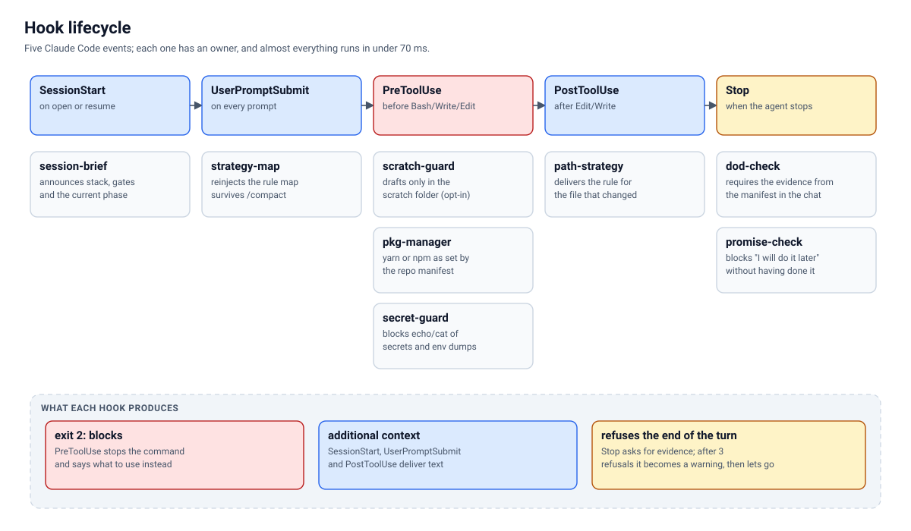
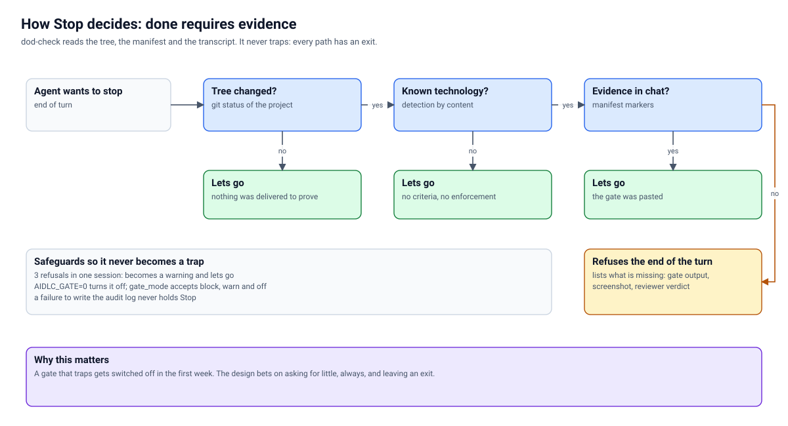
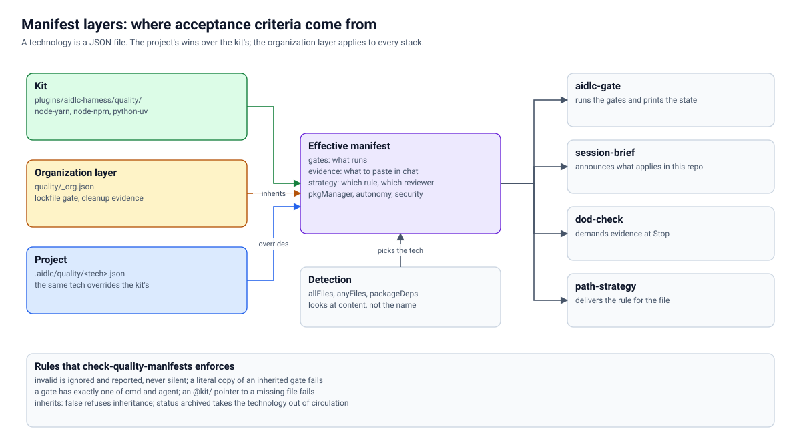

# Reference

*Also available in [Brazilian Portuguese](pt-BR/REFERENCIA.md).*

> Everything the kit has, one piece at a time: what it does, what it is called, what it returns and how to turn it off. To understand **why** it is built this way, read [ARCHITECTURE.md](ARCHITECTURE.md) and [STRATEGY.md](STRATEGY.md). To start from zero, [GETTING-STARTED.md](GETTING-STARTED.md).
>
> This file is checked by `scripts/check-reference.mjs`: a hook, executable, command, agent or skill that exists on disk and does not appear here fails CI, and so does a command cited in the prose that does not exist.

Index: [Executables](#executables) · [Hooks](#hooks) · [Commands](#slash-commands) · [Agents](#agents) · [Skills](#skills) · [Quality manifests](#quality-manifests) · [Project files](#project-files) · [Environment variables](#environment-variables-and-configuration) · [Exit codes](#exit-codes)

---

## Executables

Dependency-free Node programs, installed on the `PATH` by `node scripts/setup.mjs`. They cost no tokens: they run outside the model. All of them accept `--json` when there is machine-readable output.

Note: the messages the executables print (for example `nada sobrando`, "não rodou", `PASSOU`, `FALHOU`, `PULADO`, `PENDENTE`) are in Portuguese, because that is what the programs actually print. This document quotes them verbatim and explains them in English.

| Executable | What it is for |
| --- | --- |
| [`aidlc-init`](#aidlc-init) | Prepares a project: instructions for the three tools, cycle folders, CI workflow |
| [`aidlc-phase`](#aidlc-phase) | State of the AI-DLC phases, verified and not declared |
| [`aidlc-gate`](#aidlc-gate) | Runs the acceptance criteria of the detected technology |
| [`aidlc-scan`](#aidlc-scan) | Reads the report of any security platform and separates "clean" from "did not run" |
| [`aidlc-secscan`](#aidlc-secscan) | Scans for CVEs with a published fix (Trivy built in) |
| [`aidlc-lockcheck`](#aidlc-lockcheck) | Dependency outside the lockfile |
| [`aidlc-identity`](#aidlc-identity) | Personal or infrastructure data in the repository |
| [`aidlc-secrets`](#aidlc-secrets) | Vault the agent uses without seeing the value |
| [`aidlc-doctor`](#aidlc-doctor) | Grades the repository against the standard |
| [`aidlc-mutation`](#aidlc-mutation) | Mutation test on the critical paths |
| [`aidlc-limpeza`](#aidlc-limpeza) | Clean bench at the end of each unit |
| [`aidlc-cycle`](#aidlc-cycle) | Cycle dashboard, derived from what the kit already records |
| [`aidlc-graph`](#aidlc-graph) | Blast radius across repositories |
| [`aidlc-harness`](#aidlc-harness) | Always-on context cost |

### aidlc-init

Creates a project skeleton from the templates in `templates/`. Never overwrites without `--force`.

```text
aidlc-init [folder] [--name "Name"] [--desc "one sentence"] [--tools claude,kiro,copilot]
           [--dry-run] [--force]
aidlc-init --check     # fails if a derived copy diverged from AGENTS.md
aidlc-init --sync      # regenerates the copies from AGENTS.md
```

Creates `AGENTS.md`, `CLAUDE.md` (imports `AGENTS.md`), `.github/copilot-instructions.md`, `.kiro/steering/aidlc.md`, `context/product.md`, `.aidlc/config.json`, `.aidlc/identity.json`, `.github/workflows/aidlc-gate.yml` and the `aidlc/` folder (inception, construction, decisions, audit). `--tools` limits which tools get a file. Exits 0; `--check` exits 1 on divergence.

### aidlc-phase

```text
aidlc-phase status                  # both phases, one line each (exits 0)
aidlc-phase check inception         # exits 1 if the Inception is incomplete
aidlc-phase check construction      # requires a complete Inception AND the Construction files
```

A phase is complete when all of its files exist, do not have the `<!-- PREENCHER` marker and end with `Aprovado por:` and `Data:` (YYYY-MM-DD) filled in. These two literals, in Portuguese, are exactly what the check looks for. The name is refused if it belongs to an AI tool. Without an `aidlc/` folder, `status` exits 0 and `check` exits 1. What the command does **not** prove: that the name belongs to whoever actually approved (see [AIDLC.md](AIDLC.md)).

### aidlc-gate

```text
aidlc-gate [folder] [--only id1,id2] [--list] [--dry-run] [--json]
```

Detects the technology by content, merges the manifests (kit, organization, project) and runs the gates in order. A gate for another platform comes out as **PULADO** (skipped), never green. Exits 1 if any **blocking** gate failed, or if an agent gate (reviewer) is still pending. The results: PASSOU, FALHOU, PULADO, PENDENTE (passed, failed, skipped, pending; see [WHEN-IT-BREAKS.md](WHEN-IT-BREAKS.md)). Each run prints the kit version and the manifest hash, so the evidence states which criteria it was measured against.

### aidlc-scan

The scan contract. Reads a JSON report already produced by a security platform and answers with three outcomes, not two.

```text
aidlc-scan <report.json> [--format auto|neutro|sarif|roqueshield]
                         [--fail-on info|low|medium|high|critical]    # default: high
                         [--baseline <previous-report.json>]
                         [--require-scanners a,b] [--json]
```

| Exit | Means |
| --- | --- |
| `0` | **Clean**: complete coverage and nothing at or above the threshold |
| `1` | **Failed**: there is a finding at or above the threshold |
| `2` | **Did not run**: incomplete or unknown coverage, required scanner missing, unreadable report or nonexistent file |

With no arguments, it prints the help and exits 2. `--baseline` compares by stable key and shows resolved, remaining and new findings; a scanner that ran in the baseline and did not run now counts as "did not run". The accepted formats and what each one must carry are in [INTEGRATIONS.md](INTEGRATIONS.md).

### aidlc-secscan

```text
aidlc-secscan [--json] [--report]
```

Runs Trivy over the repository (vulnerabilities, misconfiguration and secrets, HIGH and CRITICAL severity) and fails only the CVE that is in a manifest **of the project**, has a published fix version and is not in the allowlist with a deadline. Each allowlist block needs `# expira: AAAA-MM-DD` (the literal is in Portuguese; the date is YYYY-MM-DD); an expired entry fails again. Without `trivy` installed, **it is not clean**: the output says "não rodou" (did not run). `--report` prints everything, including what does not block.

### aidlc-lockcheck

```text
aidlc-lockcheck [folder] [--since <ref>] [--json]
```

Checks, without network: (1) the lockfile of the declared package manager exists; (2) every `package.json` dependency appears in it; (3) if the dependency lists changed since `HEAD` (or `--since`), the lockfile changed along with them. It does not query the registry or measure reputation: that is the job of the `supply-chain-reviewer` agent. Without a `package.json` with dependencies, there is nothing to lock and it exits 0.

### aidlc-identity

```text
aidlc-identity [folder] [--terms file.txt] [--json]
```

Scans for IPv4, MAC, email, home path, internal hostname, secrets (known formats) and the terms **your project** forbids. The terms live outside the repository: `--terms`, the `AIDLC_IDENTITY_TERMS` variable or `~/.config/aidlc/identity-terms.txt`, one per line. A legitimate finding goes into `.aidlc/identity.json`, with `file` (glob), `categoria` and a `why` of at least 8 characters; an entry without a reason fails. Exits 1 if it finds anything, 2 if the folder does not exist. It finds formats, not names: the name of a person or customer is only caught if it is in the terms list.

### aidlc-secrets

```text
aidlc-secrets status [--json]                  # present or absent, never the value
aidlc-secrets set <name>                       # interactive prompt, once per machine
aidlc-secrets template [file]                  # generates the blank file of what is missing
aidlc-secrets import <file> [--keep]           # stores everything at once and destroys the file
aidlc-secrets exec <name|group>... -- <cmd>    # injects into the child's environment and execs
aidlc-secrets scrub                            # redacts known secrets read from stdin
```

The value enters the child process environment and disappears with it; it never goes through the screen, the transcript or a command-line argument. Storage is in `~/.config/aidlc/secrets`, mode 600. The known names and groups are in the help itself (`aidlc-secrets help`). `import` refuses, with exit 2, a file versioned by git (the values are already in the history: rotate, remove from version control and only then import).

### aidlc-doctor

```text
aidlc-doctor [folder] [--json]
```

Gives the repository a grade from 0 to 100 and says what is missing, with weights: README, `AGENTS.md`/`CLAUDE.md` under 8 KB, CHANGELOG, plugin enabled, permission allowlist, `loop.md`, a pre-push that runs the gate, an unversioned secret and, for an open repository, a coherent license, `SECURITY.md`, `CODE_OF_CONDUCT.md`, issue and PR templates, `CODEOWNERS`, CI without secrets on forks, and DCO. An item that only runs on another platform comes out marked, never green.

### aidlc-mutation

```text
aidlc-mutation [--min <score>] [--json]
```

Runs Stryker only over the manifest's `coverage.criticalPaths` and returns the mutation score. Without Stryker installed, it exits 1 saying so: honest yellow, not faked green. Without declared `criticalPaths`, it comes out "pulado" (skipped). By default it only reports; `--min` makes it fail below the score.

### aidlc-limpeza

```text
aidlc-limpeza [--todos <folder>] [--frota] [--host <ssh-target>]... [--apagar] [--json]
```

Lists what is left over at the end of a unit of work: leftover worktrees, branches and containers. With `--apagar`, it removes **only** what the remote already holds (the garbage); what would lose work (dirty worktree, commit without a remote) comes out under "decidir" (to decide) and is never deleted by it. `--frota` includes the servers in the project's `fleet/servers.json` (optional) and `--host` adds a standalone SSH target. Exits 0 with the line `aidlc-limpeza: nada sobrando` (nothing left over) and 1 while there is garbage or a pending decision; that line is the evidence the Stop hook asks for when closing a unit.

### aidlc-cycle

```text
aidlc-cycle [folder] [--since 30d] [--json]
```

Cycle dashboard, read from what the kit already records: `.claude/audit/<day>.jsonl` (evidence gate decisions), `git log` in `aidlc/` (time between phases) and `git rev-list` (delivery frequency). What has no record comes out "não medido" (not measured), never zero.

### aidlc-graph

```text
aidlc-graph blast <path|repo|contract>       # what else needs to change, and in what order
aidlc-graph diagram                          # Mermaid to embed in README and docs
aidlc-graph validate                         # graph integrity (runs in CI)
aidlc-graph list                             # nodes and contracts
```

Reads the dependency graph between repositories (`AIDLC_GRAPH`, then `.aidlc/graph.json`; there is an example in `graph/ecosystem.example.json`). It is the same query the `blast` skill uses before editing a contract.

### aidlc-harness

```text
aidlc-harness [folder] [--save] [--check] [--json]
```

Measures the context cost: the **always-on baseline** (what you pay in every session and again in each subagent) and the cost per touched file. `--save` writes `.claude/harness-baseline.json`; `--check` exits 1 if the baseline grew beyond the tolerance.

---

## Hooks

Processes that Claude Code fires. They live in `plugins/aidlc-harness/hooks/` and are registered in `hooks/hooks.json`. All of them **fail toward letting work proceed**: with no recognized technology, no readable record or in the face of any exception, they exit silently with 0. They only block (exit 2 in `PreToolUse`, refusal in `Stop`) when they are sure.

| Event | Hook | What it does | Turn off with |
| --- | --- | --- | --- |
| `SessionStart` | [`session-brief`](#session-brief) | Announces the stack, the gates and the phase in progress | blocks nothing; it is only context |
| `UserPromptSubmit` | [`strategy-map`](#strategy-map) | Re-injects the rules map; survives `/compact` | `AIDLC_STRATEGY=0` |
| `PreToolUse` | [`scratch-guard`](#scratch-guard) | Scratch work only in the scratch folder (opt-in) | `AIDLC_SCRATCH_GUARD=0` |
| `PreToolUse` | [`pkg-manager`](#pkg-manager) | `yarn` or `npm`, according to the repo manifest | only applies with a recognized technology |
| `PreToolUse` | [`secret-guard`](#secret-guard) | Blocks a command that would print a secret | `AIDLC_SECRET_GUARD=0` |
| `PostToolUse` | [`path-strategy`](#path-strategy) | Delivers the rule for the file that just changed | `AIDLC_STRATEGY=0` |
| `Stop` | [`promise-check`](#promise-check) | Blocks "I'll do it later" without having done it | `AIDLC_PROMISE=0` |
| `Stop` | [`dod-check`](#dod-check) | Requires the manifest's evidence in the chat | `AIDLC_GATE=0` |



### session-brief

Fires on `startup`, `resume` and `compact`. Writes a few lines into the context: which technology was detected, which gates exist and what has to appear in the chat before saying it is done, plus the core of the product context (`context/kernel.md`). It is short on purpose: it enters the context of every session.

### strategy-map

Fires on every prompt. On the first one and every 8 prompts (the compact window), it delivers the **full map** (rules by path and required reviewer); on the others, a short line with stack, gate and reviewer. It also delivers and clears whatever `path-strategy` left pending in the session ledger, so the pointer does not cost tokens twice.

### scratch-guard

**Opt-in**: it only acts when the project declares `scratchDir` in `.aidlc/config.json` or the `AIDLC_SCRATCH_DIR` variable. Outside a repository, a new file goes to `<scratchDir>/<topic>/`. It analyzes the **path**, never the disk (the hook may run in a container). Dotfiles and known system folders always pass. Limitation: it recognizes the macOS home and the Cowork mount point; on any other system it does not act.

### pkg-manager

Reads `pkgManager` from the `quality/<tech>.json` of the repository **where the command runs** (it follows `cd` inside the command). A `yarn` repository rejects `npm` and `npx`; an `npm` repository rejects `yarn`. With no recognized technology, it allows. It denies with exit 2 and states the right command.

### secret-guard

Denies, with exit 2, a command that would **print** a secret: `cat` of an SSH key, reading the system vault with `-w`, `env`/`printenv` dumping the environment, `echo` of a known secret variable, `cat` of a real `.env`, of a `.p8` key or of a service-account JSON (`.env.example`, `.sample` and `.template` pass). It cites the right path (`aidlc-secrets exec`). A command that merely **mentions** the file name (`ls .env`, `git check-ignore .env`) passes.

### path-strategy

Fires after `Edit`, `Write` and `MultiEdit`. It delivers, only when they exist, three things about the touched path: the rule that governs it (`strategy.paths` of the manifest), the blast radius across repositories if the file is a contract (graph) and the reviewer the stack requires before Stop. Each pointer is delivered **once per session**. It does not block or fix anything.

### promise-check

Refuses to end a turn that **promises to continue** ("I'll carry on in the next cycle", "in the next iteration I'll do it"). The rule is: either do it now, or do not promise. It does not block a pending item reported as fact ("X was left out, because Y"), a promise conditioned on a person ("when you say so") or a turn without a promise. It respects `gate_mode`.

### dod-check

The evidence gate. Reads the transcript since the person's last message, works out which evidence the technology manifest requires (`evidence`), and refuses the end of the turn if any marker does not appear. Deterministic, no model, in milliseconds. It fails toward allowing: unknown technology, clean tree (except when the turn claims to close a unit: then only the `whenSays` evidence is required) or the ceiling of **3 refusals per session**, when it becomes a warning and allows. Each decision is recorded in `.claude/audit/<day>.jsonl`; a failure to write the record never holds up the Stop. Flow details: 

---

## Slash commands

Available in Claude Code with the plugin installed. They are instructions for the agent; the verifiable work is done by the executables.

| Command | What it does |
| --- | --- |
| `/inception` | Conducts the Inception: questions in rounds, requirements, stories and units of work, until a person approves. The agent approves nothing |
| `/construction` | Conducts the Construction: design and test plan approved before the code; then, one unit of work at a time. Optional argument: unit number |
| `/gate` | Runs `aidlc-gate` and pastes the raw output. Optional argument: the id of a gate |
| `/status` | Overview of the repository on one screen (gate, standard, vault, graph, pending items), read-only |

The full text of each command is in [pt-BR/PROMPTS.md](pt-BR/PROMPTS.md) (Portuguese), which is **generated** from `commands/` (`node scripts/gerar-prompts.mjs`).

## Agents

Claude Code subagents, in `plugins/aidlc-harness/agents/`. The split follows cost: the cheap one surveys, the expensive one decides.

| Agent | Model | When to use |
| --- | --- | --- |
| `scanner` | haiku, low effort | Mechanical scan without judgment: inventory, drift, key diff, lint output triage. Returns structured data, not opinion |
| `supply-chain-reviewer` | haiku, low effort | After editing a dependency manifest or lockfile: the package exists, has an owner, the name does not imitate another, it is pinned |
| `advisor` | opus, high effort | On demand and never every turn: a big decision, refuting a finding, unblocking a gate that failed twice, an irreversible action. It does not inherit the conversation: it receives the diff or a briefing |

A gate of type `agent` in a manifest must name an agent that exists here; `check-plugin.mjs` fails the opposite.

## Skills

In `plugins/aidlc-harness/skills/<name>/SKILL.md`. The agent loads them by their description.

| Skill | When |
| --- | --- |
| `aidlc-context` | A task that requires product judgment: naming, writing user-facing text, assessing scope. Reads `context/product.md` |
| `blast` | **Before** editing a file that may be a contract between repositories: uses `aidlc-graph blast` |
| `bolts` | Starting or resuming a large project: plan everything, split into units (bolts), close each one with a test, evidence and cleanup |
| `repo-standard` | Bringing a repository up to the kit standard when `aidlc-doctor` is low |

---

## Quality manifests

The acceptance criteria as data. They live in `plugins/aidlc-harness/quality/<tech>.json`, validated by `_schema.json` (`node scripts/check-quality-manifests.mjs`).



### Manifests that ship with the kit

| `tech` | Recognized by | Manager | Gates |
| --- | --- | --- | --- |
| `node-yarn` | `package.json` + `yarn.lock` | yarn | `test`, `lint`, `build`, `secscan`, `supply-chain` |
| `node-npm` | `package.json` + `package-lock.json` | npm | `test`, `lint`, `build`, `secscan`, `supply-chain` |
| `python-uv` | `pyproject.toml` + `uv.lock` | uv | `lint`, `format`, `lockfile`, `segredo`, `unit` |
| `harness-self` | the plugin folder + `OPERATING-MODEL.md` | n/a | `test`, `syntax`, `quality-manifests`, `plugin`, `docs`, `prompts`, `identity` |

`_org.json` is the **organization layer**: it is not a technology, it applies to every stack that matches its `when` (today the `lockfile` gate and the unit-closing evidence). A project manifest in `.aidlc/quality/<tech>.json` with the same `tech` **overrides** the kit one. The security gate template is in `templates/security/node-yarn-com-scan.json`.

### Manifest fields

| Field | Required | What it is |
| --- | --- | --- |
| `tech`, `label`, `repos` | yes | Kebab-case identifier (equal to the file name), readable name, repositories that run on this stack |
| `status` | no | `active` (default) or `archived` (out of circulation: no gate, no loop, no doctor grade) |
| `pkgManager` | no | `yarn`, `npm`, `gradle`, `spm` or `none`. Source of truth for `pkg-manager` |
| `platform` | no | `any` (default), `darwin` or `win32`: where the gate can actually run |
| `autonomy` | no | `observe`, `advise`, `approve` (default) or `breaker`: how much the agent does on its own, declared as data |
| `detect` | yes | `allFiles` (AND), `anyFiles` (OR), `packageDeps` and `priority` (higher wins; default 50). Looks at the content, not the folder name |
| `gates` | yes | List of gates (below) |
| `evidence` | yes | What has to appear in the chat before declaring done (below) |
| `coverage` | no | `global`, `critical`, `criticalPaths`: feeds `aidlc-mutation` |
| `security` | no | Which gate fulfills `sca`, `sast`, `pinning`, `review`. Absent means there is **no** barrier |
| `strategy` | no | What to read before writing, by path (below) |
| `notes` | no | Free text |

**Gate**: `id`, `label`, `blocking` (required); exactly one of `cmd` (shell command) and `agent` (reviewer); `expect` (substring the output must contain), `reject` (substring that fails), `platform`, `autonomy`, `model` (`haiku`, `sonnet`, `fable` or `inherit`, for an agent gate), `timeoutMs` (default 600000) and `$why` (minimum 40 characters: the real defect that made the gate exist; without a written reason, it is the first one someone removes when it gets in the way).

**Evidence**: `id`, `label`, `markers` (regexes; any one satisfies); `whenTouches` (globs: only required if the session touched a file that matches); `whenSays` (regexes against the last message: required when it claims what matches, and enforced even with a clean tree); `$why`.

**Strategy**: `always` (valid pointers for any file of the stack) and `paths[]`, each with `when` (globs), `why` (one line: what breaks if ignored), `read` (rules or documents to open) and `reviewer` (agent that must review before Stop). The `@kit/` prefix resolves at the kit root wherever it is; a `@kit/` pointer to a nonexistent file fails the check.

### What `check-quality-manifests` enforces

An invalid manifest is **ignored and reported**, never silent; a literal copy of a gate inherited from the organization layer fails; `inherits: false` refuses inheritance; a gate has exactly one of `cmd` and `agent`; an invalid regex in `markers` fails; a `strategy` cut without `when` fails; a `@kit/` pointer to a nonexistent file fails; a gate's agent must exist in `agents/`.

---

## Project files

What `aidlc-init` creates and what it is for.

| File | Purpose |
| --- | --- |
| `AGENTS.md` | **The single source** of the rules for any AI tool. The only instruction file edited by hand |
| `CLAUDE.md` | Imports `@AGENTS.md` and adds only what is specific to Claude Code |
| `.github/copilot-instructions.md`, `.kiro/steering/aidlc.md` | **Derived** copies of `AGENTS.md` (`aidlc-init --sync`); `--check` fails on divergence |
| `context/product.md` | What the product is, what has already been decided, the team vocabulary |
| `context/kernel.md` | Three lines that change the framing, injected by `session-brief` |
| `aidlc/inception/` | `requirements.md`, `user-stories.md`, `units-of-work.md` |
| `aidlc/construction/` | `design.md`, `test-plan.md` |
| `aidlc/decisions.md` | What was decided and is not reopened |
| `aidlc/audit/` | Record of the cycle decisions |
| `.aidlc/config.json` | `tools`, `language`, `scratchDir` (all optional) |
| `.aidlc/identity.json` | `aidlc-identity` allowlist, each entry with a reason |
| `.aidlc/quality/<tech>.json` | Project manifest; overrides the kit one |
| `.claude/audit/<day>.jsonl` | Evidence gate decisions (feeds `aidlc-cycle`) |
| `.github/workflows/aidlc-gate.yml` | Runs `aidlc-init --check` and `aidlc-gate` in CI; pins the kit by `AIDLC_REF` |

## Environment variables and configuration

| Variable | Effect |
| --- | --- |
| `AIDLC_GATE=0` | Turns off the evidence gate and the other Stop hooks. Emergency kill switch: it beats everything |
| `CLAUDE_PLUGIN_OPTION_GATE_MODE` | The plugin's `gate_mode` option: `block` (default), `warn` or `off`. Applies to `dod-check` and `promise-check` |
| `AIDLC_PROMISE=0` | Turns off only `promise-check` |
| `AIDLC_SECRET_GUARD=0` | Turns off only `secret-guard` |
| `AIDLC_STRATEGY=0` | Turns off `strategy-map` and `path-strategy` |
| `AIDLC_SCRATCH_DIR` | Scratch folder; turns on `scratch-guard` without editing `config.json` |
| `AIDLC_SCRATCH_GUARD=0` | Turns off `scratch-guard` |
| `AIDLC_AUDIT=0` | `dod-check` stops writing `.claude/audit/` |
| `AIDLC_IDENTITY_TERMS` | File with the terms the project forbids, for `aidlc-identity` |
| `AIDLC_GRAPH` | Path of the repository graph for `aidlc-graph` and `path-strategy` |
| `AIDLC_REF` | In the CI workflow, the tag or commit of the kit to use. **Pin it to a tag or commit you reviewed** |

## Exit codes

Uniform convention: **0** succeeded, **1** failed or there is a pending item, **2** could not decide (never confuse it with 0).

| Command | 0 | 1 | 2 |
| --- | --- | --- | --- |
| `aidlc-gate` | all blocking gates passed | a blocking gate failed or a reviewer is pending | n/a |
| `aidlc-scan` | clean | failed | **did not run** |
| `aidlc-phase check` | phase complete | incomplete | n/a |
| `aidlc-identity` | nothing found | found something or allowlist without a reason | nonexistent folder |
| `aidlc-limpeza` | `nada sobrando` | garbage or pending decision | n/a |
| `PreToolUse` hook | allows | n/a | **blocks** the command |
